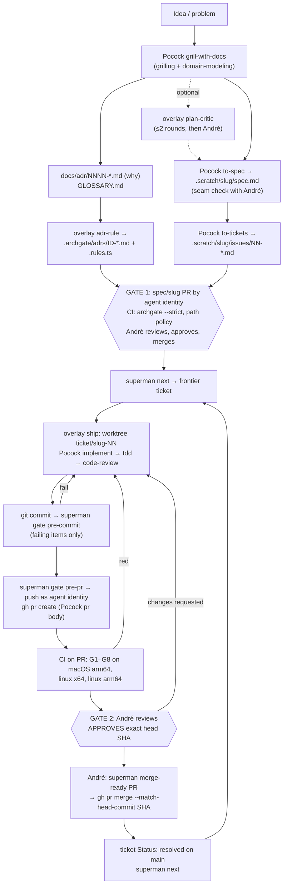

# superman v0

**Status:** ready-for-agent

*Spec for Gate 1 (milestone M1). Reshaped into Matt Pocock's `to-spec` template (mattpocock/skills@59db609eb1e18aaf59b63284d0e52255aff0c63c) from André's approved draft "superman v0 specification" (written 2026-10-29, Europe/Berlin). The draft's numbered sections are kept, with their numbers, under the template headings, so cross-references like "§5.4" still work. Changes made during M1 are marked **(M1 amendment)** and listed in Further Notes, "Amendments made in M1"; the 2026-10-29 tooling round (Biome, Trivy, tsrs, the `superman-ai` name) is listed there as Amendment 2, and the 2026-10-29 change-aware CI round (affected analysis, gate cache, milestone M7b) as Amendment 3, marked **(M1 amendment 3)**.*
*Draft sources: `decisions.md` (authoritative; "hitl" there means `superman`), `zoom-out-northstar-autobahn-archgate.md`, `survey.md`, `magus-notes.md`, both Gemini chats, the repos `ai-catapult`, `r3dlex/skills`, `mattpocock/skills@59db609`, and `legiox-workspace@8768c7b`.*
*Conventions: **VERIFY** marks a fact nobody has checked hands-on yet. **(rec, confirm)** marks a decision that `decisions.md` lists as recommended but still pending André's explicit OK. Questions 1–13 in §15 are resolved; questions 14–23 are open **(M1 amendment 3)**. Glossary: `GLOSSARY.md`. Decisions: `docs/adr/0001`–`0011` (why) and `.archgate/adrs/` (enforced).*

## Problem Statement

### 1. Problem

- **The human gate exists only on paper.**
  - Across 269 merged PRs in four of André's repos there were **0 approvals**.
  - The same account (`br4vesirrobin`) authored and merged every PR, with a median of 5.5 min from open to merge in lx.
  - lx contains standing "override and do not stop" merge-authority waivers.
  - The default approval mode was `agent-self`.
- **The tooling is heavy and not TS.** autobahn and northstar total about 11.5k lines, including about 6.7k lines of Python and 1.8k of bash. They depend on the OMC/OMX daemons and take about 30k tokens of context when their modules load.
- **"Archgate" in lx is a name, not an enforcer.**
  - `.rules.ts` holds generic Express/React prose rules for an Elixir/Vue/Rust repo.
  - `scripts/validate-rules.sh` only greps the structure of that file.
  - `AGENTS.md` says semantic enforcement is "agent behavior at PR review time".
- **No repo runs vanilla Pocock or knows its Pocock SHA.**
  - Pocock reaches repos through a 20-skill modified fork that is 55 commits stale.
  - lx `upstream.lock` says `"unresolved-at-scaffold-time"`.
- **Nothing blocks slop on merge.** There are no knip, duplication or mutation gates, and none of the CI runs on macOS arm64.

## Solution

superman is a thin TypeScript CLI, `superman`, plus an overlay of at most three skills on top of Matt Pocock's skills, which are used unmodified and pinned by SHA. A separate agent identity writes code and opens PRs; only André approves the exact head SHA and merges. Deterministic gates (Archgate rules derived from ADRs, typecheck (tsrs) and tests, Biome lint and format, a Trivy scan, knip, duplication and mutation ratchets, a protected-path policy, traceability and test-first evidence) run locally and in CI, print only failures, and have no waiver. Work flows through two human gates: Gate 1 reviews the spec, tickets, ADRs and rules before any code exists, and Gate 2 reviews each ticket PR. superman ships as one npm package, `superman-ai` (CLI command `superman`), that is also installable as a plugin in Claude Code, Codex and OpenCode **(M1 amendment, §12.1)**.

### 2. Goals (v0)

1. **An approval agents cannot forge.** Every merge to `main` in a pilot repo carries an APPROVED review by André on the exact head SHA, with CI green on that SHA. The author is the bot and André does the merge.
2. **Executable architecture.** ADR-derived rules run in `archgate check --strict`. Agents see only failing rules.
3. **Day-1 no-slop gates with no waivers** (§5.4).
4. **Vanilla Pocock, pinned by SHA**, plus a tiny overlay of at most 3 skills.
5. **Light in context and execution.** Small skills, progressive disclosure, fast commands, zero runtime dependencies.
6. **Pilots:** a new TS repo for superman itself, and legiox-workspace.

### 4. Principles

1. **Humans approve, agents prepare.** Agents produce evidence and never satisfy a gate. A gate change goes through Gate 1, never through a waiver.
2. **Identity is the control.** Gate security comes from the bot lacking write access and from the approval being tied to André's account, not from prose in a SKILL.md.
3. **Deterministic first.** Anything checkable lives in the CLI or CI. Skills only hold judgment and sequencing.
4. **Vanilla upstream.** Pocock files are never edited. An overlay skill never reuses a Pocock skill name or job, to avoid skill clash (arXiv 2610.25064).
5. **Show only failures.** On success a command prints `ok`. On failure it prints `{rule, file, line, message, fix}` lines, about 2 KB at most. Full detail goes to the JSON receipt.
6. **Zero runtime dependencies and no hidden processes.** Node built-ins only. External tools (`git`, `gh`, `archgate`, `tsrs`, `biome`, `knip`, `jscpd`, `stryker`, `trivy`) are pinned devDependencies, pinned CI binaries or PATH tools that `doctor` checks **(M1 amendment)**.
7. **Code over stale prose.** Every generated AGENTS.md block opens with: "If this file disagrees with the code or CI, the code and CI win; flag the drift." (arXiv 2610.30571.) Every directive carries a reason.
8. **Thin slices.** One ticket is one PR, and every milestone below is one PR, except M7b, a milestone group with one PR per ticket **(M1 amendment 3)**.

## User Stories

Actors: **André** (the approver, `br4vesirrobin`), **the agent** (an AI coding agent working as the agent identity), **a pilot repo maintainer** (André maintaining superman or legiox-workspace), and **a harness user** (anyone installing superman into Claude Code, Codex or OpenCode).

1. As André, I want every merge to `main` to carry my APPROVED review on the exact head SHA, so that the human gate is real and not a formality.
2. As André, I want the agent to author commits and PRs under its own identity, so that author and approver are always different accounts.
3. As André, I want the agent to be unable to push to `main`, approve or tag, so that my approval cannot be forged by the agent.
4. As André, I want `superman doctor` to refuse to run when the active GitHub identity is mine, so that an agent session never acts as me by accident.
5. As André, I want to switch the agent identity between a GitHub App and a machine-user by changing config only, so that I can harden later without code changes.
6. As André, I want `superman merge-ready <pr>` to re-check author, approval SHA, check runs, PR kind and path policy from the forge, so that I merge on evidence and not on what CI claims.
7. As André, I want `merge-ready` to print a merge command pinned to the head SHA, so that a push after my approval makes the merge fail.
8. As André, I want `superman audit` to list merged PRs without a valid approval, merges by non-approvers and direct pushes, so that bypasses are detected where they cannot be prevented.
9. As André, I want to review the spec, tickets, ADRs and rules in one Gate 1 PR before any code exists, so that rules are reviewed apart from the code they constrain.
10. As André, I want each ticket's `Kind:` (behavior or refactor) fixed at Gate 1, so that the agent cannot pick the easier test-first rule later.
11. As André, I want ticket PRs that touch protected paths to fail CI, so that an agent cannot move the goal posts inside the work they measure.
12. As André, I want duplication and mutation baselines that only tighten in ticket PRs, so that quality cannot erode one PR at a time.
13. As André, I want no waiver mechanism at all, so that changing a gate always costs a reviewed spec PR.
14. As André, I want gate failures to print only the failing items in about 2 KB, so that agents fix exactly what failed and I can read the output.
15. As André, I want every gate run to write a deterministic JSON receipt, so that audits and metrics rest on evidence.
16. As André, I want behavior tickets to show a red test commit before the first source commit, and refactor tickets to stay green at every commit, so that TDD is checked and not just requested.
17. As André, I want CI to run on macOS arm64, linux x64 and linux arm64, so that the gates hold on the machines we use.
18. As André, I want superman to have zero runtime dependencies and no shell or Python files, so that the tool guarding merges has a minimal supply chain.
19. As André, I want Pocock's skills installed unmodified at a pinned SHA with a hash lock, so that I always know which skill text the agents used.
20. As André, I want a local warning when the installed Pocock files drift from the lock and a CI failure when the lock and catalog disagree, so that pin changes go through a reviewed PR.
21. As André, I want `implement-spec` excluded from the installed Pocock subset, so that no subagent merges tickets past Gate 2.
22. As André, I want the overlay to stay at three user-invoked skills within fixed line budgets, so that context cost and skill clash stay small.
23. As André, I want each Archgate ADR to link the `docs/adr` decision it enforces, so that every rule is traceable to a reviewed reason.
24. As André, I want to publish npm releases only by pushing a `v*` tag myself, so that the agent cannot release.
25. As André, I want npm releases to use trusted publishing with provenance and no stored token, so that there is no long-lived publish secret to leak.
26. As the agent, I want `superman next` to list unblocked, unclaimed tickets, so that I pick work in dependency order.
27. As the agent, I want the `ship` skill to walk me from a ticket to an open PR through the gates, so that I follow one known path.
28. As the agent, I want `superman gate pre-commit` to finish in about 10 seconds, so that I get fast feedback on every commit.
29. As the agent, I want `superman gate pre-pr` to run the same checks as CI, so that I see failures before I push.
30. As the agent, I want a "Rule conflict" section in my PR to be the place to raise a rule I think is wrong, so that I never edit protected files to get green.
31. As the agent, I want to stop and report after the same gate fails three times, so that I do not loop or weaken anything.
32. As the agent, I want the `adr-rule` skill to turn an accepted decision into an Archgate rule with a failing fixture, so that new rules are proven before Gate 1.
33. As the agent, I want an optional `plan-critic` round before `to-spec`, so that weak plans are caught early without a daemon.
34. As a pilot repo maintainer, I want `superman init` to write config, lock, ratchet, hook, AGENTS block, CODEOWNERS and CI from templates byte-stably, so that adoption is one reviewed PR and re-running it shows no diff.
35. As a pilot repo maintainer, I want to configure the why-ADR directory, glossary file, protected paths and gate commands, so that polyglot repos like legiox-workspace adopt superman without moving files.
36. As a pilot repo maintainer, I want Elixir mutation testing (muex) to use the same ratchet, so that lx gets the same no-slop bar.
37. As a harness user, I want to install the superman overlay as a Claude Code plugin from the `r3dlex/superman` marketplace, so that `ship` and `adr-rule` are available as skills.
38. As a harness user, I want to install the same overlay as a Codex plugin, so that Codex sessions follow the same flow.
39. As a harness user, I want OpenCode to load the same overlay skills, so that the flow is harness-independent.
40. As a harness user, I want `npx superman-ai doctor` to work from npm **(M1 amendment)**, so that I can run superman without cloning the repo.
41. As a harness user, I want every harness to read one copy of each skill file, so that the lock's hashes describe what every harness loads.
42. As André, I want lint, format and a vulnerability, secret and misconfiguration scan to block merges with no ignore files, so that agents can't ship sloppy code or a known-vulnerable dependency **(M1 amendment)**.
43. As André, I want the fast tsrs type checker as the gate but watched against the official `tsc`, so that a beta checker can't silently pass wrong code **(M1 amendment)**.
44. As the agent, I want PR CI to run only the tests of the targets my change affects, with the reason for each target in the receipt, so that CI stays fast without hiding what it skipped **(M1 amendment 3)**.
45. As André, I want every push to `main` and a nightly job to run the full suite, and `superman audit` to count the failures PR runs missed, so that affected mode switches itself off when it selects too little **(M1 amendment 3)**.
46. As a pilot repo maintainer, I want superman to use moon, Nx or Turborepo when my repo already has one, and its own providers for TS/JS, Elixir, Rust, C#, Python and Haskell otherwise, so that polyglot repos like lx get change-aware CI without adopting a build tool **(M1 amendment 3)**.
47. As the agent, I want gate results cached by a hash of their inputs, locally, in the Actions cache and in a remote store that only trusted runs on `main` can write, so that unchanged targets are not re-run and a PR can't poison the cache **(M1 amendment 3)**.
48. As a pilot repo maintainer, I want `superman init` to write the affected config, the CI template with a nightly full job and the cache wiring, and `doctor` to show which providers are active, so that a new repo uses change-aware CI from its first PR **(M1 amendment 3)**.

## Implementation Decisions

### 5. Architecture

#### 5.1 Components

| Component | What | Where |
|---|---|---|
| `superman` CLI | TS, Node ≥26 **(M1 amendment)**, zero runtime deps; deterministic gates, merge check, skill pinning, receipts | npm `superman-ai` (bin `superman`) **(M1 amendment)**. `superman` and `superman-cli` are taken on npm and André owns no `@r3dlex` scope, checked 2026-10-29 |
| Overlay plugin | Skills `ship`, `adr-rule`, optional `plan-critic` | Bundled in the npm package under root `skills/`, with Claude Code and Codex plugin manifests pointing at the same files **(M1 amendment, §12.1)** |
| Pocock skills | Unmodified, at the SHA in `superman.lock.json` | Installed as a pinned plugin from the `r3dlex/superman` catalog (see §5.6). Not vendored |
| Archgate CLI | Executes `.archgate/adrs/*.rules.ts` | devDependency `archgate@0.61.0` (exact pin), `ARCHGATE_TELEMETRY=0` |
| tsrs **(M1 amendment)** | Primary type checker, `--noEmit` only, default mode (never `--fast`) (ADR 0008) | devDependency `tsrs@0.20.1-ts7.1.0-beta` (exact pin; tracks TypeScript 7.1.0-beta), native binary via its `@tsrs/*` optionalDependencies |
| Biome **(M1 amendment)** | Lint + format for TS/JS/JSON, replaces ESLint and Prettier (G10, ADR 0009) | devDependency `@biomejs/biome@2.6.4` (exact pin), config `biome.json` (protected) |
| Trivy **(M1 amendment)** | `trivy fs` scan: vulnerable deps, secrets, misconfig; HIGH/CRITICAL fail (G11, ADR 0009) | CI: release tarball `v0.76.1` downloaded from `github.com/aquasecurity/trivy/releases` and checked against a sha256 committed in the workflow; locally a PATH tool. Never `trivy-action`/`setup-trivy` |
| Forge | PRs, reviews, check runs | GitHub in v0 (via `gh`); GitLab/ADO later |

#### 5.2 CLI commands

Every command exits 0 (ok), 1 (gate failed), or 2 (misconfigured or tool error). Every gate command writes a receipt (§5.5).

| Command | Does | Notes |
|---|---|---|
| `superman init [--repo-kind ts\|polyglot]` | Writes `superman.config.json`, `superman.lock.json`, `superman.ratchet.json`, `.archgate/config.json` (if missing), the `GEN-001` meta-rule, `.superman/hooks/pre-commit`, a precedence block in `AGENTS.md`, `CODEOWNERS` lines, and the CI workflow from a template; sets `git config core.hooksPath .superman/hooks` | Idempotent and byte-stable: re-running it yields no diff. Refuses to overwrite a changed file without `--force`, and prints a diff instead |
| `superman doctor` | Checks environment and identity (§9.3), tool pins (including tsrs and Biome), whether `trivy` is on PATH and its version, that `TSRS_FAST` is unset (warns otherwise), `ARCHGATE_TELEMETRY=0`, Node/pnpm/git versions, that lock hashes match the files on disk, and that the hooks path is set; **(M1 amendment 3)** the active affected providers and their tool versions, a warning when the glob fallback is used, and whether affected mode is off because of misses | **Refuses to run (exit 1) when the active forge identity is the approver (André).** The `ship` skill runs it first |
| `superman gate pre-commit` | On staged files: `archgate check --staged`; typecheck; `biome check --staged --no-errors-on-unmatched` (G10) **(M1 amendment)**; tests of the affected targets of the staged files (§5.7) **(M1 amendment 3)**; knip; a protected-path check | Target p50 under 10 s on the superman repo. Prints failing items only |
| `superman gate pre-pr [--base origin/main]` | Full typecheck (tsrs) and tests; `archgate check --base --strict`; `biome ci` (G10); `trivy fs` (G11) when `trivy` is on PATH, otherwise `n/a (enforced in CI)` **(M1 amendment)**; knip; jscpd ratchet; Stryker on changed files (from the change model, §5.7, **M1 amendment 3**); branch↔ticket↔spec link; PR-kind path policy (§5.4) | Same commands CI runs. Locally it is a fast-fail preview, and CI is authoritative |
| `superman gate pre-pr\|ci --affected` **(M1 amendment 3)** | Runs G2 tests only for affected targets and scopes G1, G5, G6 and G10 to the change model (§5.7). Any force-full trigger, provider error, unclaimed changed file, shallow clone or active miss ledger switches the run to full and says why | A `push` to the base branch and `gate nightly` ignore `--affected` and always run full |
| `superman affected [--base <ref>] [--staged] [--json]` **(M1 amendment 3)** | Prints the change model: changed files, affected targets with reason chains, the provider of each, and any force-full trigger | Read-only. The same code path the gates use |
| `superman merge-ready <pr>` | Verifies Gate 2 or Gate 1 on GitHub through `gh api` (§9.2) | André runs it before merging. On success it prints the exact `gh pr merge <pr> --match-head-commit <sha>` command (that flag: VERIFY on current gh) |
| `superman skills sync` | Writes the project's `.claude/settings.json` catalog and enabled-plugin entries, and computes per-file sha256 values for the pinned Pocock commit and the overlay into the lock. A copy fallback applies only for harnesses that can't pin plugins (see §5.6) | Never edits skill files |
| `superman skills lock --pocock <sha>` | Bumps the pin and re-syncs. The result is a normal PR that André reviews | Never runs on its own |
| `superman skills verify` | Locally, compares the installed plugin cache to the lock and **warns** on a different SHA or edited files. In CI, **fails** if the lock, the catalog `sha` and the config's skill list disagree | Locally it warns, in CI it is a hard gate (G7) |
| `superman next` | Lists unblocked, unclaimed tickets from `.scratch/<slug>/issues/` | Read-only |
| `superman audit [--since <date>]` | Lists merged PRs on `main` and flags any without a valid approval (bot author, André APPROVED on the merged head, CI green), plus direct pushes. **(M1 amendment 3)** Also reports affected-mode misses per repo and provider and the rate against `affected.missThreshold` (§5.7) | Read-only. Feeds the metrics in §13 **(M1 amendment: was §12)** |

**Out of v0:**
- `superman merge`: an auto-merge after the same re-check. It needs a token with write access, which v0 deliberately keeps away from agents.

#### 5.3 Config: `superman.config.json`

Plain JSON validated by a hand-written TS validator (no zod), with a `$schema` path to a schema shipped in the package. Every field is shown below.

```json
{
  "$schema": "./node_modules/superman-ai/schema/config.v1.json",
  "version": 1,
  "forge": { "kind": "github", "repo": "r3dlex/superman", "baseBranch": "main" },
  "identity": {
    "approvers": ["br4vesirrobin"],
    "agent": { "mode": "app", "app": { "slug": "r3dlex-superman-bot", "installationOwner": "r3dlex" } }
    // alt: "agent": { "mode": "machine-user", "login": "r3dlex-bot" }
  },
  "tracker": { "kind": "local", "root": ".scratch" },
  "paths": {
    "whyAdrs": "docs/adr",
    "glossary": "GLOSSARY.md",   // M1 amendment; lx keeps CONTEXT.md (question 6)
    "rules": ".archgate/adrs",
    "protected": [".archgate/**", "docs/adr/**", ".claude/settings.json", "superman.lock.json",
                  "superman.*.json", ".github/workflows/**", "CODEOWNERS", ".superman/**", "biome.json"]   // biome.json: M1 amendment
  },
  "branches": { "spec": "spec/{slug}", "ticket": "ticket/{slug}-{nn}" },
  "gates": {
    "typecheck": ["pnpm", "exec", "tsrs", "--noEmit"],   // M1 amendment: tsrs primary (ADR 0008); revert = ["pnpm","exec","tsc","--noEmit"]
    "lint": ["pnpm", "exec", "biome", "ci"],               // G10, M1 amendment
    "lintStaged": ["pnpm", "exec", "biome", "check", "--staged", "--no-errors-on-unmatched"],
    "trivy": ["trivy", "fs", "--scanners", "vuln,secret,misconfig", "--severity", "HIGH,CRITICAL",
              "--include-dev-deps", "--exit-code", "1", "."],   // G11; PATH tool locally
    "test": ["pnpm", "exec", "vitest", "run"],
    "testRelated": ["pnpm", "exec", "vitest", "related", "--run"],
    "knip": { "enabled": true, "workspaces": ["."] },
    "jscpd": { "enabled": true, "paths": ["src"], "minTokens": 50 },
    "mutation": { "enabled": true, "tool": "stryker", "mutate": ["src/**/*.ts", "!src/**/*.test.ts"] },
    "archgate": { "strict": true }
  },
  "affected": {                                    // M1 amendment 3 (§5.7, ADR 0010/0011)
    "enabled": true,
    "providers": "auto",                           // or an ordered list of "moon"|"nx"|"turbo"|"ts"|"elixir"|"rust"|"csharp"|"python"|"haskell"|"glob"
    "global": [],                                  // any change here forces a full run
    "links": [],                                   // cross-language edges, e.g. { "from": "proto/**", "to": ["rust:api", "ts:web"] }
    "globs": [],                                   // last-resort mapping: { "match": "apps/x/**", "target": "x", "test": ["…argv"] }
    "ignore": ["**/*.md", "docs/**", ".scratch/**"],  // files no target owns that may not force a full run (question 19)
    "forceFull": [],                               // added to the built-in force-full triggers (§5.7)
    "missThreshold": 0.02,
    "missResetAt": null,                           // set by a spec PR to re-enable after an auto-off
    "cache": {
      "local": true,
      "actions": true,
      "remote": { "url": null, "bucketPrefix": "superman", "publicKey": null }   // ADR 0011; null = tier off
    },
    "deploy": {}                                   // design only in v0 (ticket 26)
  },
  "skills": {
    "pocock": ["grill-with-docs", "grilling", "domain-modeling", "to-spec", "to-tickets",
               "implement", "tdd", "code-review", "pr", "diagnosing-bugs", "handoff",
               "setup-matt-pocock-skills"],
    "overlay": ["ship", "adr-rule"],
    "delivery": "plugin",
    "catalog": { "repo": "r3dlex/superman", "pocockSha": "59db609eb1e18aaf59b63284d0e52255aff0c63c" },
    "onDrift": "warn"
  }
}
```

**Rules for gate commands:**
- Commands are argv arrays and are never run through a shell.
- `superman` calls them with `spawn(..., {shell: false})`.
- A gate with `enabled: false` is reported as `n/a` and never as `pass`.
- A gate can only be enabled or disabled through a PR that is allowed to touch protected paths (§5.4).

**`superman.lock.json`:**

```json
{ "version": 1,
  "pocock": { "repo": "mattpocock/skills", "sha": "59db609eb1e18aaf59b63284d0e52255aff0c63c",
              "files": { "skills/engineering/tdd/SKILL.md": "sha256-…" } },
  "overlay": { "package": "superman-ai", "version": "0.1.0", "files": { "…": "sha256-…" } },
  "tools": { "archgate": "0.61.0", "tsrs": "0.20.1-ts7.1.0-beta", "biome": "2.6.4", "trivy": "0.76.1",
            "node": "26", "pnpm": "12.16.1" } }
```

**(M1 amendment 3)** `tools` also records the provider CLIs superman calls in that repo (`moon`, `nx`, `turbo`, `elixir`, `cargo`, `dotnet`, `cabal` or `stack`, `pytest`), as `init` finds them. `doctor` warns when the version on PATH differs, and the cache key includes the resolved versions (ADR 0011).

**`superman.ratchet.json`:**
- Holds the jscpd and mutation baselines, for example `{ "jscpdPct": 1.2, "mutationScore": 82.4 }`. **Ratchet (decided 2026-10-29):** the first measured value is the baseline, there are no fixed thresholds, and a PR may not lower the mutation score on the files it changes or raise jscpd duplication. Nightly full runs may tighten the baseline. Lowering one requires a spec PR.
- Ticket PRs may **only tighten** these numbers. Lowering one requires a spec PR.

#### 5.4 Gates (day 1, merge-blocking, no waivers)

| # | Gate | Local (pre-commit) | CI on every PR (required) | Nightly on `main` |
|---|---|---|---|---|
| G1 | `archgate check --strict` | `--staged` | `--base origin/main --strict --output github` | full |
| G2 | Typecheck + tests. Typecheck = `tsrs --noEmit` (exact pin, default mode) **(M1 amendment, ADR 0008)** | typecheck + `vitest related` | full typecheck and test suite, on all 3 OS legs | non-blocking drift job: pinned TS7 `tsc --noEmit` diffed against tsrs; any diff fails that job and opens an issue |
| G3 | knip (unused files, exports, deps) | yes | yes, must report 0 issues | — |
| G4 | No `.archgate/**` or `docs/adr/**` edits in ticket PRs (the whole protected list, §5.3) | yes | yes, by PR kind | — |
| G5 | jscpd duplicate-code ratchet | changed files | total duplication % ≤ `jscpdPct`, and no new clone that touches changed files | full report |
| G6 | Stryker mutation ratchet | off (too slow) | incremental on the PR's changed `src` files: score ≥ `mutationScorePr` | full run: score ≥ `mutationScore`, otherwise the job fails and opens an issue |
| G7 | Pocock unmodified | — | `superman skills verify` | — |
| G8 | Traceability | — | branch `ticket/{slug}-{nn}` ↔ `.scratch/{slug}/issues/{nn}-*.md` exists on base ↔ `.scratch/{slug}/spec.md` exists on base | — |
| G9 | Test-first (red→green) on `ticket/*` PRs | — | see below | — |
| G10 | Biome lint + format, replaces ESLint and Prettier **(M1 amendment, ADR 0009)** | `biome check --staged --no-errors-on-unmatched` | `biome ci` (whole repo), on all 3 OS legs | — |
| G11 | Trivy `fs`: vulnerable deps (incl. dev), secrets, misconfig; fails on HIGH/CRITICAL; no `.trivyignore` (SUP-007) **(M1 amendment, ADR 0009)** | off; pre-pr runs it if `trivy` is on PATH, otherwise `n/a (enforced in CI)` | `trivy fs --scanners vuln,secret,misconfig --severity HIGH,CRITICAL --include-dev-deps --exit-code 1 .` on linux-x64 | same scan on `main` (new CVEs against unchanged deps); a failure opens an issue |

**PR kinds and the paths each may touch (G4):**
- **`spec/*`** (Gate 1):
  - May touch `.scratch/<slug>/**`, `docs/adr/**`, `.archgate/adrs/**`, `GLOSSARY.md`, and the ratchet and config files.
  - **No source code**, so the rules are reviewed separately from the code they constrain.
- **`ticket/*`** (Gate 2):
  - May not touch any protected path.
  - May edit only the `Status:` line of its own ticket file.
  - May raise `superman.ratchet.json` numbers but never lower them.
- **`chore/skills-*`:** may touch only the skill folders and `superman.lock.json`.
- **Every PR kind** needs André's approval. The PR-kind rules only stop goal-post moving *inside* implementation work.

**Test-first details (G9, merge-blocking from day one):**
- Applies to every `ticket/*` PR. The ticket file carries `Kind: behavior` (the default) or `Kind: refactor`, set in the Gate 1 spec PR, so the kind is reviewed by André before any code exists. This is not a waiver: the agent cannot change it in the ticket PR (G4).
- **`Kind: behavior`:**
  - The PR's commits (merge-base..head, no merge commits allowed) must include at least one **red commit** that touches only test paths (`paths.tests`, e.g. `**/*.test.ts`, lx: `test/**/*_test.exs`) before the first commit that touches non-test source.
  - CI checks out the last red commit and runs only the tests it added or changed (`testCmd.related`, e.g. `vitest run <files>` or `mix test <files>`). They **must fail**, and the failure must be an assertion or a missing-symbol error, not a syntax or config error in the test file itself (VERIFY: classify reliably with Vitest JSON reporter and ExUnit formatter).
  - At head the same tests **must pass** (already covered by G2, re-asserted by file).
- **`Kind: refactor`:** no new or changed test assertions are required, but the full suite must pass at every commit in the PR (no red step allowed), and G6 must not drop.
- The result goes into the receipt as `testFirst: { redSha, tests[], redOutcome, greenOutcome }`, and `merge-ready` checks it on the approved head SHA.
- The `ship` skill makes the agent commit the failing test first (Pocock's `tdd` loop), so G9 checks evidence the workflow already produces.
- Cost: one extra targeted test run per PR. Squash-merge is still fine, because the check runs on the PR's commits before merge.

**Stryker details:**
- The test runner is **Vitest**. Its Stryker plugin has full incremental support, while `node --test` has no Stryker runner (VERIFY), so the superman repo uses Vitest for tests.
- On a PR, `superman` takes the changed files from the change model (§5.7, **M1 amendment 3**) and passes them through `--mutate`. It also passes `--incremental` with `reports/stryker-incremental.json`, restored from the nightly cache.
- Stryker's `--since` flag is reported by third parties but is not in the official docs: VERIFY before using it instead of `--mutate`.
- The nightly full run uses `--force` to avoid incremental blind spots.

**Platform note:**
- Archgate has no linux-arm64 binary, so on the linux-arm64 CI leg G1 reports `n/a (enforced on linux-x64 leg)`.
- This is not a waiver: the linux-x64 job is required and runs G1.
- **(M1 amendment)** tsrs publishes native packages for `darwin-arm64`, `linux-x64-gnu` and `linux-arm64-gnu` (npm metadata, 2026-10-29), so G2 runs on all three legs. Only linux x64 has been checked hands-on (VERIFY the other two in ticket 01's matrix; a missing platform is a revert trigger in ADR 0008).
- **(M1 amendment)** G11 runs once, on the linux-x64 leg, because the scan result does not depend on the OS; the other legs report `n/a (enforced on linux-x64 leg)`. Trivy also ships Linux-ARM64 and macOS-ARM64 tarballs for local use.
- **(M1 amendment 3) Change-aware scope.** With `--affected`, PR runs scope G1, the G2 tests, G5, G6 and G10 to the change model (table in §5.7); typecheck, knip, G4, G7–G9 and G11 stay as above. A `push` to `main` and the nightly job run every gate in full, and the nightly job reads no cache. G5's total-% check moves to `main` and nightly in affected mode (question 17); "no new clone touching changed files" stays per PR.

#### 5.5 Receipts (JSON)

- **Locations:**
  - Local receipts go to `.git/superman/receipts/<kind>-<headSha>-<ts>.json`. They are never committed.
  - CI uploads its receipt as a workflow artifact `superman-receipt-<sha>`.
- **Schema:**
  - The writer is deterministic: sorted keys and no volatile fields except `startedAt`/`durationMs`.
  - Example:
```json
{ "schema": "superman.receipt/1", "kind": "gate.pre-pr", "repo": "r3dlex/superman",
  "baseSha": "…", "headSha": "…", "branch": "ticket/receipts-03", "prKind": "ticket",
  "tools": { "superman": "0.1.0", "archgate": "0.61.0", "node": "26.x", "stryker": "…" },
  "results": [ { "gate": "archgate", "status": "pass", "durationMs": 41 },
               { "gate": "mutation", "status": "fail", "score": 74.1, "threshold": 80,
                 "survivors": [ { "file": "src/x.ts", "line": 12, "mutator": "ConditionalExpression" } ] } ],
  "verdict": "fail", "startedAt": "…", "durationMs": 48210 }
```
- **`affected` block (M1 amendment 3, §5.7):** every gate receipt records the change model it used. `mode` is `affected` or `full`, and `forceFull` names the trigger when the mode is full:
```json
{ "affected": { "mode": "affected", "base": "…", "head": "…",
    "changedFiles": [ { "path": "src/gates/jscpd.ts", "status": "M" } ],
    "providers": [ { "id": "ts", "version": "superman 0.1.0", "precision": "file", "confidence": "exact" } ],
    "targets": [ { "id": "ts:test/gates/jscpd.test.ts", "provider": "ts",
                   "reasons": [ "src/gates/jscpd.ts → test/gates/jscpd.test.ts (import)" ],
                   "testCommand": [ "pnpm", "exec", "vitest", "run", "test/gates/jscpd.test.ts" ],
                   "cached": null } ],
    "forceFull": null, "missLedger": { "state": "on", "rate": 0.0 } } }
```
  A cache hit sets `cached: { "key": "sha256-…", "tier": "remote", "producerSha": "…" }` on that target.
- **merge-ready receipt:** records `prNumber`, `author`, `approver`, `reviewId`, `reviewCommitId == headSha`, the `checkRuns[]` on headSha, and `verdict`.
- **Purpose:** receipts are evidence for `audit` and the metrics. They do not replace the forge as the record of approval.

#### 5.6 Skills installation and context budget

- **Delivery: a pinned plugin, not vendored (decided 2026-10-29).**
  - `r3dlex/superman` carries `.claude-plugin/marketplace.json` with two entries:
    - `pocock`: source `git-subdir`, with `url: mattpocock/skills`, `path: skills`, `sha: 59db609eb1e18aaf59b63284d0e52255aff0c63c`. The entry lists only the 12 selected skill paths. That subdirectory has no `plugin.json`, so the entry is the manifest and `implement-spec` is never installed (VERIFY in M9).
    - `superman`: the overlay (`ship`, `adr-rule`, `plan-critic`), from the same repo at a tagged release.
  - Each pilot repo's `.claude/settings.json` registers the catalog through `extraKnownMarketplaces` and enables both plugins. This is a protected path.
  - `superman.lock.json` holds the Pocock SHA, the overlay version and a sha256 for every skill file.
  - **Drift:** `superman doctor` and `skills verify` warn locally when the installed plugin's SHA or files differ from the lock. CI fails when the lock and the catalog disagree. Bumping the pin is a normal `skills lock` PR that André reviews.
  - **Limits:** the plugin cache lives under `~/.claude` and an agent running as the same macOS user can edit it, so the warning detects drift but doesn't prevent it. This is accepted for v0, and a container or VM is the later fix.
  - **Other harnesses:** Codex and Copilot also have plugin marketplaces, but whether they can pin a SHA is VERIFY. If they can't, `skills sync --copy` writes a **gitignored** copy into `.agents/skills/`, checked against the same lock. **(M1 amendment:** §12.1 now makes Codex and OpenCode first-class install targets; the copy fallback stays for harnesses that can't pin.**)**
  - **Name prefixing:** plugin skills are invoked as `pocock:<name>`, and Pocock's skills reference each other by bare name. M9 must confirm that those handoffs still resolve (VERIFY).
- **Pocock subset (confirmed with Q4).** The flow set in §5.3: 12 skills, with `diagnosing-bugs` and `handoff` confirmed in (2026-10-29). `implement-spec` is **not** installed: its merger subagent merges tickets into an integration branch, which conflicts with Gate 2 per ticket. Parallel work uses one worktree and one ticket PR per frontier ticket, through `ship`.
- **Context budget.**
  - Overlay `ship` ≤150 lines and `adr-rule` ≤80 lines, plus `plan-critic` ≤60.
  - All three are `disable-model-invocation: true`, so they cost 0 baseline tokens.
  - The only always-loaded text is a ≤25-line superman block in AGENTS.md.
- **No harness hooks in v0.** Claude/Codex hooks are optional later work and would have to be Node scripts reading stdin JSON. Git's `pre-commit` hook is a Node-shebang file:

```js
#!/usr/bin/env node
// .superman/hooks/pre-commit — generated by `superman init`; no bash.
import { spawnSync } from "node:child_process";
const r = spawnSync("superman", ["gate", "pre-commit"], { stdio: "inherit" });
process.exit(r.status ?? 2);
```

#### 5.7 Change model, affected targets and the gate cache (M1 amendment 3, ADR 0010, ADR 0011)

**One change model per run.**
- `superman` computes the changed files once: `git diff --name-status <merge-base>...<head>` (renames and deletions included) in `gate ci` and `gate pre-pr`, and the staged files in `gate pre-commit`. CI checks out with `fetch-depth: 0`; a shallow clone or a missing base forces a full run, never a guess.
- Providers map files to **affected targets**: the targets that own a changed file, plus every target that depends on one (reverse closure). Deleted and renamed files are resolved against the base graph as well as the head graph, so the old importers of a deleted file are affected.
- Each target carries the test command to run, the files that are its gate inputs, and a reason chain such as `src/x.ts → src/y.ts (import) → test/y.test.ts`.
- The result goes into the receipt (`affected`, §5.5) before any gate runs. Every gate reads it, and none computes its own change set. `superman affected [--base <ref>] [--staged] [--json]` prints the same result, read-only.
- **This replaces** the separate changed-file logic in tickets 04 (pre-commit related tests), 05 (G9 red-run file list stays commit-based and is unchanged) and 06 (Stryker `--mutate` list, jscpd "clones touching changed files").

**Provider interface.**
```ts
interface AffectedProvider {
  id: string;                                    // "moon" | "nx" | "turbo" | "ts" | "elixir" | "rust" | "csharp" | "python" | "haskell" | "glob"
  detect(repo: Repo): Promise<boolean>;
  affected(input: { changed: ChangedFile[]; base: string; head: string }): Promise<{
    targets: { id: string; files: string[]; testCommand: string[] | null; reasons: string[] }[];
    claimed: string[];                           // changed files this provider owns
    precision: "file" | "package" | "project";
    confidence: "exact" | "heuristic";
  }>;
}
```
- Several providers can be active at once (lx: Elixir + Rust + TS). Results merge by target id; a file claimed by two providers is affected in both.
- Cross-language edges go through `affected.global` (a change there forces a full run) or `affected.links` (`{ "from": "proto/**", "to": ["rust:sarif-core", "ts:web"] }`).
- **Detection order:** a monorepo tool when its config is present, then the language-native providers for the languages the tool does not cover, then `affected.globs` as a last resort. `doctor` lists the active providers and **warns** whenever the glob fallback is used.
- **Fail toward full:** a changed file that no provider claims and that matches no `affected.ignore` glob, a provider exit code other than 0, or a tool missing from PATH all switch the run to full and record why.

**Providers in v0.**

| Provider | Mechanism | Precision | Test command per target | Status |
|---|---|---|---|---|
| moon | `moon query projects --affected --downstream deep` with the change model's files on stdin (`moon query changed-files` output form); JSON `{ projects, options }` | project | `moon run <project>:test` is *not* used; superman runs the target's configured test argv | Verified in moon docs (v1.29+ `--downstream`; v2 `moon query affected --base --head`). Stdin form: VERIFY with a fixture |
| Nx | `nx show projects --affected --base=<sha> --head=<sha> --json` | project | the project's configured test argv | Verified in Nx docs |
| Turborepo | `turbo ls --filter=...[<base>...<head>] --output=json` | package | the package's configured test argv | `--filter=...[<range>]` (changed + dependents, merge-base semantics) verified in Turborepo docs; `turbo ls --output=json`: VERIFY |
| TS/JS | superman's own import-graph parser (`src/affected/ts.ts`): static `import`/`export … from`/`require`/literal `import()` specifiers, resolved with TypeScript's rules (`tsconfig` `paths` and `baseUrl`, `extends`, `package.json` `exports`/`imports` conditions, workspace packages, extension and `index` probing). Reverse closure from the changed files, then the test files that reach them | file | `gates.testRelated` + the affected test files (`vitest run <files>`) | Own code, no external VERIFY. Non-literal `import()` makes the importing package's whole test set affected |
| Elixir | `mix xref graph --format json --output -` (source → sinks with `compile`/`export`/`runtime` labels; exact JSON shape: VERIFY on Elixir 1.19) for the reverse closure; umbrella apps via `in_umbrella` deps in each `mix.exs`. Test files are selected per affected app; within an app, test files whose source names a module defined in an affected file (heuristic) | file (heuristic) / app | `mix test <files>` in the app; locally `mix test --stale` is offered as a faster path | `--format json` exists since Elixir 1.19 (verified). `mix test --stale` needs the previous run's manifest, so CI does not rely on it (verified caveat). lx Elixir version ≥ 1.19: VERIFY |
| Rust | `cargo metadata --format-version 1`: `workspace_members` and `resolve.nodes[].deps[]` (with `dep_kinds`) give crate edges; a file belongs to the crate whose manifest directory contains it | package | `cargo test -p <crate>` for each affected crate and its reverse dependencies | Verified in the Cargo Book |
| C# | `dotnet sln list` for the projects, `<ProjectReference>` items parsed from each `.csproj` (or `dotnet reference list --project <p>`, which lists direct references only) for edges; `Directory.Build.props`/`.targets` and `Directory.Packages.props` are force-full | project | `dotnet test <affected test project>` | `dotnet sln list` and `dotnet reference list` verified in Microsoft Learn (`dotnet list reference` before .NET 10 SDK). `dotnet test` with Microsoft.Testing.Platform vs VSTest argument form: VERIFY |
| Python | superman's own static import graph, parsed in TS: `import x`, `from x import y`, relative imports, `src/` layout and packages from `pyproject.toml`; `conftest.py` changes affect every test below its directory | file | `pytest <affected test files>`; when the repo already uses `pytest-testmon`, `pytest --testmon` locally | pytest-testmon flags verified in its docs (`--testmon`, `.testmondata`). superman never ships or runs Python itself (§3) |
| Haskell | package level only: `cabal.project` packages and each `.cabal` file's `build-depends` (or `stack.yaml` packages) | package | `cabal test <pkg>` or `stack test <pkg>` | Both target forms verified in the cabal and stack docs. Module-level precision is later (§3) |
| glob | `affected.globs` `{ match, target, test }` | as configured | as configured | Last resort; `doctor` warns |
| Go (post-v0) | `go list -deps -json ./...` (`ImportPath`, `Deps`, `Imports`) | package | `go test <affected packages>` | Fields verified in `cmd/go` docs; ticket 25 |

**Force-full triggers** (built in; `affected.forceFull` adds to them):
- every protected path from `paths.protected` (workflows, `superman.config.json` and every `superman.*.json`, the lock, `.archgate/**`, `docs/adr/**`, `biome.json`, `.superman/**`, `CODEOWNERS`);
- lockfiles of every detected language: `pnpm-lock.yaml`, `package-lock.json`, `yarn.lock`, `bun.lock`, `mix.lock`, `Cargo.lock`, `packages.lock.json`, `poetry.lock`, `uv.lock`, `Pipfile.lock`, `requirements*.txt`, `cabal.project.freeze`, `stack.yaml.lock`, `go.sum`;
- toolchain pins and root build config: `tsconfig*.json`, root `package.json`, `.nvmrc`, `.tool-versions`, `rust-toolchain(.toml)`, root `Cargo.toml`, root `mix.exs`, `config/*.exs`, `global.json`, `Directory.Build.*`, `Directory.Packages.props`, `*.sln`, `pyproject.toml` (root), root `conftest.py`, `.python-version`, `cabal.project*`, `stack.yaml`, `go.mod`;
- provider config: `.moon/**`, `nx.json`, `turbo.json`, the `affected` section itself (it lives in the protected config);
- `affected.global` paths.

**Which gates are change-aware.**

| Gate | PR with `--affected` | `main` push and nightly |
|---|---|---|
| G1 Archgate | `archgate check --strict <changed files + affected targets' files>` (0.61.0 accepts a file list, checked locally) | full |
| G2 tests | affected targets' test commands only | full suite |
| G2 typecheck, G3 knip, G11 Trivy | whole repo (cheap or whole-program) | whole repo |
| G5 jscpd | changed files plus the files of affected targets: no new clone touching a changed file. The total-% ratchet is checked on `main` and nightly (open question 17) | full report and total % |
| G6 mutation | Stryker `--mutate <changed src files> --incremental`; muex `--since <base>` | full, `--force` |
| G10 Biome | `biome ci --no-errors-on-unmatched <changed files + affected targets' files>` (Biome takes paths) | whole repo |
| G4, G7, G8, G9 | unchanged (already diff- or commit-based) | — |

**Gate cache (ADR 0011).**
- **Cache key** = sha256 of canonical JSON: `{ schema: "superman.cache/1", gate, target, argv, tools (lock pins + resolved binary versions), configHash (the config sections the gate reads), os, arch, env (allowlist), inputs: sorted [path, sha256] }`. Inputs are the target's files, its transitive dependencies from the provider, and the `global` paths.
- Only **pass** results are stored. A hit skips that gate for that target, and the receipt records `cached: { key, tier, producerSha }`.
- **Tiers:** local `.git/superman/cache/`; the Actions cache (restored and saved by a pinned `actions/cache` step; GitHub scopes PR saves to `refs/pull/<n>/merge`, so a PR can't write what `main` reads); a remote S3-compatible store (R2 by default) at `<prefix>/v1/<repo>/ac/<key>.json`, spoken to with Node `fetch` plus SigV4 from `node:crypto`.
- **Remote trust:** untrusted runs (every PR, including forks with no secrets) are read-only. Only `push` and `schedule` runs on `main`, inside the `superman-cache-write` Environment restricted to `main`, can write. Entries are Ed25519-signed; the public key is `affected.cache.remote.publicKey` in the protected config; readers recompute the key, verify the signature and treat any mismatch as a miss.
- **Nightly never reads the cache**, so it is the oracle for misses. `main` pushes may read it (open question 15).
- Optional: when a repo already has moon's or Nx's remote cache, superman leaves it on for that tool's own tasks; superman's entries always go to its own store.

**Miss tracking (`superman audit`).**
- Input: receipts of the nightly and `main` full runs and of each merged PR's last affected run (the `superman-receipt-<sha>` artifacts; artifact retention: VERIFY, default 90 days).
- A **miss** is a target that fails in a full run, fails again on one rerun (flake filter), and was not selected by an affected run of a PR merged since the last green full run. It is attributed to that PR and to the provider that owns the target.
- Rate = misses ÷ merged affected-mode PRs, per repo and per provider, over the §13 pilot window. Above `affected.missThreshold` (default 0.02), the nightly job writes a signed **miss ledger** to the trusted cache namespace; `gate ci --affected` reads it and runs full for that repo or provider, printing why; `doctor` and `audit` report it. A missing or invalid ledger means full mode. Re-enabling takes a spec PR that sets `affected.missResetAt`.

**Affected deploys (design only in v0; ticket 26 is post-v0).** `affected.deploy` maps a deployable target to `{ build, deploy, environment }` argv. On `main`, `superman deploy --affected` would compute the change model between the last successful deployment's SHA (from the forge's deployments API) and the head, and build and deploy only the affected deployable targets; force-full triggers deploy everything. Nothing in v0 runs deploys.

### 6. Overlay plugin skills (outlines)

#### 6.1 `ship`: ticket → PR, ≤150 lines, `disable-model-invocation: true` (confirmed)

```
---
name: ship
description: Ship one approved ticket as a PR through superman gates as the agent identity. Use after the spec PR (Gate 1) merged.
disable-model-invocation: true
---
Precedence: superman/CI output beats this file. Never approve, never merge, never waive.
1 Preconditions (10): `superman doctor` exit 0 (bot identity, pins, telemetry off). Spec at .scratch/<slug>/spec.md is on main.
2 Pick (8): `superman next`; take the first unblocked ticket; set its Status: claimed (local only).
3 Workspace (12): worktree from origin/main on branch ticket/<slug>-<NN> (App mode: in the upstream repo; machine-user mode: in the bot fork).
   `archgate review-context --staged` once → keep only listed ADR ids/titles.
4 Build (20): Pocock `implement` with the ticket ref (it calls `tdd` and `code-review`).
5 Commit loop (20): commits go through the pre-commit hook; on failure fix ONLY the printed items.
   Protected paths are off-limits. If a rule looks wrong: stop, write the conflict into the PR
   description under "Rule conflict", and do not edit the rule.
6 Pre-PR (10): `superman gate pre-pr`; Pocock `pr` for the body; add "Ticket: .scratch/<slug>/issues/<NN>-…md".
7 Open (10): `superman pr open` (pushes per identity mode and opens the PR); request André's review.
8 Review loop (20): address comments; re-run pre-pr; push; never resolve André's threads yourself.
9 Hand-off (10): when CI is green, comment "Ready: run `superman merge-ready <pr>`". André merges.
10 Stop rules (10): same gate fails 3× → stop and report; any request to skip/waive/lower a gate → refuse and
   suggest a spec PR; never touch a token/account other than the bot's.
```

#### 6.2 `adr-rule`: a docs/adr decision → an Archgate rule, ≤80 lines (confirmed)

```
---
name: adr-rule
description: Turn an accepted docs/adr decision into an Archgate ADR + .rules.ts with a fixture. Use during a spec branch only.
disable-model-invocation: true
---
1 Guard (5): branch must be spec/*; else stop.
2 Decide (10): is the decision mechanically checkable (path, import, grep, file-presence, AST for TS)?
   If not, write "not enforceable" into the docs/adr file's Consequences and stop.
3 Create (15): `archgate adr create --title … --domain … --files <globs> --rules --json`;
   body line 1: `Source: docs/adr/NNNN-slug.md`.
4 Rule (25): smallest check in .rules.ts using ctx.grep/ctx.glob/ctx.ast only; no imports beyond node:path|url|util|crypto;
   every violation has message + fix; for non-TS repos use text-level grep only.
5 Prove (15): add a failing fixture under .archgate/fixtures/<ID>/ and confirm `archgate check --adr <ID>`
   fails on it and passes on the repo. (Fixture mechanism: VERIFY against archgate 0.61 rule-testing support.)
6 Hand to Gate 1 (10): list ADR id, rule ids, files globs in the spec PR body.
```

#### 6.3 `plan-critic`: optional Planner→Architect→Critic, ≤60 lines (confirmed)

- This is the daemon-free version of chat 2's `/ralplan`, with chat 2's patches to Pocock removed.
- **When it runs:** after `grill-with-docs` and before `to-spec`.
- **Steps:**
  1. Write the draft plan to `.scratch/<slug>/plan.md`.
  2. Spawn two **fresh read-only subagents**, Architect and Critic. Each reads only its rubric, the plan, `GLOSSARY.md`, `docs/adr/` and the cited files.
  3. Each returns `{verdict, blocking_flaws[], notes[]}`.
  4. Revise the plan and repeat, for **at most 2 rounds**.
  5. If either still rejects, **stop and present the trade-off to André**.
- **Explicitly not adopted from chat 2:**
  - Auto-writing ADRs (`domain-modeling` and `adr-rule` own that).
  - The "to-spec fast-track" that skips Pocock's seam check. That check is one of the HITL points, and Pocock stays unmodified.

**northstar and autobahn:**
- northstar is **replaced** by Pocock `grill-with-docs → to-spec → to-tickets` plus Gate 1. (confirmed)
- autobahn is **rewritten** as `ship` plus the `superman` CLI. (confirmed)
- Neither skill ships in v0.

### 7. End-to-end flow



### 8. CI templates

**GitHub Actions first.** `superman init` renders `.github/workflows/superman.yml`. Sketch:

```yaml
name: superman
on:
  pull_request: { branches: [main] }        # fork PRs; no pull_request_target anywhere
  push: { branches: [main] }
  schedule: [{ cron: "17 2 * * *" }]        # nightly full Stryker + audit
permissions: { contents: read }              # never write on PR runs
env: { ARCHGATE_TELEMETRY: "0" }
jobs:
  gates:
    strategy:
      fail-fast: false
      matrix: { os: [macos-15, ubuntu-24.04, ubuntu-24.04-arm] }   # runner labels: VERIFY for private repos
    runs-on: ${{ matrix.os }}
    steps:
      - uses: actions/checkout@<sha>       # all actions pinned by full SHA
        with: { fetch-depth: 0 }
      - uses: pnpm/action-setup@<sha>
      - uses: actions/setup-node@<sha>
        with: { node-version: 26, cache: pnpm }   # M1 amendment: Node 26
      - run: pnpm install --frozen-lockfile
      - name: Install Trivy (pinned, sha256-checked; M1 amendment)   # never trivy-action/setup-trivy (GHSA-69fq-xp46-6x23)
        if: runner.os == 'Linux' && runner.arch == 'X64'
        env: { TRIVY_VERSION: "0.76.1", TRIVY_SHA256: "c7cbe3137fb8a48a17574bede3dd6beb16742d1e9772929940fc90082c39d9c0" }
        run: |
          curl -fsSLo trivy.tgz "https://github.com/aquasecurity/trivy/releases/download/v${TRIVY_VERSION}/trivy_${TRIVY_VERSION}_Linux-64bit.tar.gz"
          echo "${TRIVY_SHA256}  trivy.tgz" | sha256sum -c -
          tar -xzf trivy.tgz -C "$RUNNER_TEMP" trivy && echo "$RUNNER_TEMP" >> "$GITHUB_PATH"
      - uses: actions/cache@<sha>            # M1 amendment 3: gate cache tier 2 (ADR 0011); PR saves are scoped to refs/pull/<n>/merge
        with: { path: .git/superman/cache, key: "superman-gates-${{ runner.os }}-${{ runner.arch }}-${{ github.sha }}", restore-keys: "superman-gates-${{ runner.os }}-${{ runner.arch }}-" }
      - run: pnpm exec superman gate ci --base origin/${{ github.base_ref || 'main' }} ${{ github.event_name == 'pull_request' && '--affected' || '' }}   # G1–G11; never sets TSRS_FAST; M1 amendment 3: --affected on PRs only, main runs full
        env: { SUPERMAN_CACHE_URL: "${{ vars.SUPERMAN_CACHE_URL }}" }   # M1 amendment 3: remote tier, read-only on PRs (no secret)
      - uses: actions/upload-artifact@<sha>
        if: always()
        with: { name: superman-receipt-${{ matrix.os }}, path: .superman-ci/receipt.json }
  nightly:
    if: github.event_name == 'schedule'
    runs-on: ubuntu-24.04
    environment: superman-cache-write        # M1 amendment 3: the only job with the cache write credential and signing key (ADR 0011)
    permissions: { contents: read, issues: write }
    steps: [ "...", { run: "pnpm exec superman gate nightly" } ]  # full Stryker --force, jscpd full, Trivy on main, audit; M1 amendment 3: never --affected, reads no cache, writes the miss ledger and cache entries (SUP-008)
  tsc-drift:                                 # M1 amendment: non-blocking, never a required check (ADR 0008)
    if: github.event_name == 'schedule'
    runs-on: ubuntu-24.04
    permissions: { contents: read, issues: write }
    steps:
      - "...checkout, pnpm install --frozen-lockfile..."
      - run: pnpm exec tsrs --noEmit --pretty false > tsrs.txt || true
      - run: pnpm exec tsc --noEmit --pretty false > tsc.txt || true    # devDependency typescript, exact pin = the version tsrs tracks
      - run: diff -u tsc.txt tsrs.txt                                    # any drift fails this job; a follow-up step opens an issue
```

- **`gate ci`** is `pre-pr` plus G7 and G8, with CI-specific output formats (`--output github` annotations).
- **No secrets.** PR jobs need no secrets, so fork PRs work with the default read-only token.
- **Required checks.** Required status checks are only enforceable with branch protection or rulesets (§9.4).
- **Archgate in CI.** Archgate is installed through the pinned devDependency. Its npm shim downloads the binary on first use (about 30 s). Cache `~/.archgate/bin` keyed on the version.
- **Polyglot repos (lx).** The template adds the repo's own typecheck and test commands through config. For example: `mix compile --warnings-as-errors`, `mix test`, `cargo test`, `vue-tsc --noEmit`.
- **Biome and Trivy in CI (M1 amendment).** Biome comes from its exact-pinned devDependency. Trivy is downloaded from its GitHub release at a pinned version, and the sha256 is checked against `trivy_<v>_checksums.txt`, copied into the workflow when the pin changes. Pin bumps are spec-kind PRs. In March 2026 `aquasecurity/trivy-action` and `setup-trivy` had their tags hijacked and Trivy v0.69.4 was malicious (GHSA-69fq-xp46-6x23, CVE-2026-33634). That is why the pin is to a reviewed release, never `latest`, and why no Trivy action is used. Trivy's misconfig scanner does not cover GitHub workflow files (VERIFY); workflow linting (actionlint or zizmor) is a later candidate, not a v0 gate.
- **tsrs in CI (M1 amendment).** The three-OS matrix is also tsrs's platform check. CI never sets `TSRS_FAST` and never passes `--fast` (SUP-006). `superman` also strips `TSRS_FAST` from the environment it gives gate processes. The `tsc-drift` job is scheduled and non-blocking. Its pinned TypeScript is the version in tsrs's version suffix (`7.1.0-beta` today).
- **Linters for lx (M1 amendment).** Biome covers TS/JS/JSON only, so it runs in `apps/web/assets`. G10 for Elixir is `mix format --check-formatted`, plus `mix credo --strict` if credo is a dependency (VERIFY). Rust uses `cargo fmt --check` and `cargo clippy -- -D warnings`. There is no Ruff and no Python tooling for superman itself; the Python affected provider (§5.7) parses a target repo's Python from TS and runs that repo's own `pytest` **(M1 amendment 3)**.
- **Affected mode and the gate cache (M1 amendment 3, §5.7, ADR 0010/0011).** PR runs pass `--affected`; a `push` to `main` and the nightly job run full. `fetch-depth: 0` is required, because a shallow clone forces a full run. Only the nightly job and `main` pushes run inside the `superman-cache-write` Environment, restricted to `main`; PR jobs still have no secrets and read the remote tier through the public endpoint. The `main`-push leg's Environment wiring is part of ticket 24's follow-up. SUP-008 keeps raw test steps and an `--affected` nightly out of every workflow.
- **GitLab CI and ADO** come after v0.
  - The same `superman gate ci` entrypoint.
  - `merge-ready` checks GitLab MR approvals and pipeline SHA, and ADO PR votes and policy evaluations.
  - **Order (decided 2026-10-29): Azure DevOps first, then GitLab.** ADO maps cleanly: required reviewer policy + build validation policy on the PR, `merge-ready` reads PR reviewer votes (approve = 10) and the policy evaluations API for the iteration's source commit, and the bot is a separate ADO identity with Contribute on its own branches only (ADO has no forks for private projects in most setups; VERIFY fork support vs. a branch-permission model).
  - GitLab after that. Approval semantics differ, especially on GitLab Free (VERIFY).

### 9. Security of the approval gate

#### 9.1 Threat model

**What we defend against:**
- An agent approving its own work. The past failure: 0/269 real approvals, plus the 27% pattern in arXiv 2610.28683.
- An agent merging.
- An agent loosening a gate inside the PR that a gate is checking.
- An approval going stale after a later push.
- Stale prose being treated as authority.

**What is out of scope:** a compromised André account, or a malicious maintainer of Archgate or Pocock. Pinning reduces that risk but doesn't remove it.

#### 9.2 What `merge-ready <pr>` verifies (all must hold)

1. The PR author is the configured agent identity (`<slug>[bot]` in App mode, the bot login in machine-user mode) and is **not** in `identity.approvers`. The head repo is the upstream repo with a `spec/`, `ticket/` or `chore/` branch (App mode) or the bot's fork (machine-user mode).
2. `headSha` is taken from the PR at the moment of the check.
3. The latest review by an approver is `APPROVED` and has `commit_id == headSha`. No approver's latest review is `CHANGES_REQUESTED`. The approver is not the author.
4. Every check run and commit status on `headSha` has concluded `success`, or `neutral`/`skipped` only where config allows it. The required job names from config are present. An empty set fails.
5. The PR kind matches its branch. The changed files obey the path policy of that kind, recomputed from `gh api …/pulls/<n>/files`, not trusted from CI.
6. The base is `main`, and the PR is mergeable (not conflicted).
7. The merge itself is checked by `audit`: in App mode the merge actor must be an approver; a merge by the App is flagged even after approval. *(M1: moved here from between items 1 and 2.)*

**Output:**
- On success, a receipt plus the merge command pinned to the SHA (`--match-head-commit`). It fails if the head moved.
- On failure, one reason line per failed condition.

#### 9.3 Identity setup and `doctor` checks

**Agent identity: two supported modes, chosen by `identity.agent.mode` (decided 2026-10-29).**

- **`app` (v0 default): GitHub App `r3dlex-superman-bot` on the `r3dlex` org.**
  - Chosen because GitHub blocked machine-user sign-up from the agent browser, and the org is on the free plan.
  - Private App, no webhook, installed only on selected repos. Permissions: contents, pull requests, workflows: write; metadata, checks, statuses, actions: read.
  - `superman` mints a 1-hour installation token from the App private key (`SUPERMAN_APP_KEY_PATH`, chmod 600, only in the agents' environment) and passes it to `gh` via `GH_TOKEN`. No long-lived token.
  - It pushes `spec/*`, `ticket/*`, `chore/*` branches to the upstream repo. The `main` ruleset (no bypass, 1 approval, last-push approval, dismiss stale) means it can't push to `main` or approve its own PR. A tag ruleset blocks tag create/update/delete.
  - **Accepted trade-off:** after André approves the head SHA, the App *could* press merge. `merge-ready` prints the merge command for André, and `audit` flags any merge whose actor isn't an approver.
- **`machine-user` (supported for later): a separate account such as `r3dlex-bot`.**
  - Read role as an outside collaborator, PRs from its own fork, 2FA, a classic PAT with `repo` + `workflow` and a 90-day expiry in its own `GH_CONFIG_DIR`. Fine-grained PATs can't contribute as an outside collaborator.
  - Stronger guarantee: it literally can't merge. Switch by changing `identity.agent` and running `superman doctor`; no code changes.
- Both modes go through one `forge/identity.ts` interface (`token()`, `pushRemote()`, `prHead()`, `expectedAuthor()`), with fixture tests for each mode from M4.

**`superman doctor` fails if any of these hold:**
- `gh api user` returns an approver login.
- `GH_TOKEN`/`GITHUB_TOKEN` resolves to an approver.
- The push remote doesn't match the mode (upstream in App mode, the bot fork in machine-user mode).
- App mode: the installation's permissions differ from the expected set, the installation covers repos beyond `identity.agent.app.repos`, or the key file is readable by others.
- The approver appears in `gh auth status` for this `GH_CONFIG_DIR`.
- Machine-user mode: `gh api repos/{repo}/collaborators/{bot}/permission` is anything other than `read`.
- `ARCHGATE_TELEMETRY` is not `0`.
- The archgate, Node or pnpm versions differ from the lock.

**Residual risk.** If the agent runs in André's own OS session, his gh token, keychain and SSH agent are reachable, and an agent could approve as André.
- v0 decision: agents run on the same Mac and the same macOS user, with their own `GH_CONFIG_DIR` and `GH_TOKEN` holding only bot credentials, no SSH agent, and `doctor` refusing approver identities. André keeps his `gh` token fine-grained and short-lived and approves in the browser. A container or VM is the planned hardening step (open question 4, resolved).
- `doctor` can detect the obvious cases but can't prove isolation.
- `audit` flags reviews submitted via the API by the approver within N seconds of the agent's push. This is a heuristic.

#### 9.4 GitHub limits and settings to verify

| Item | Status |
|---|---|
| Branch protection and rulesets on **private org** repos need a paid plan (GitHub **Team**). The zoom-out saw a 403 "Upgrade to GitHub Pro" on the personal-workspace repo. For `r3dlex`-org repos the relevant plan is Team | VERIFY plan and price |
| Without protection, "only André merges" rests on **permissions**: the bot has Read, cannot push to `main`, and cannot merge. Required reviews and required checks are **not** enforced by GitHub, so André could still merge a red PR. `merge-ready` plus `audit` cover that by discipline and detection, not by prevention | design fact |
| Org setting "Allow forking of private repositories" and the repo setting "Allow forking" must both be on, or the bot cannot fork | VERIFY |
| Actions for fork PRs on private repos: "Run workflows from fork pull requests" on; "Send write tokens to workflows from fork pull requests" **off**; "Send secrets and variables to workflows from fork pull requests" **off**; whether "Require approval for fork PR workflows" applies to outside collaborators (it may add a click per push) | VERIFY each in org and repo settings |
| Never use `pull_request_target` or `workflow_run` with a PR-head checkout. Every action is pinned by SHA | design rule |
| CODEOWNERS (`* @br4vesirrobin`) only *requests* review without protection. It is kept as documentation | design fact |
| Private-repo Actions minutes: macOS minutes carry a multiplier, and `ubuntu-24.04-arm` availability and pricing for private repos | VERIFY. This bears on open question 3 |
| Public repos get rulesets, required reviews and required checks free, plus free standard runners, macOS and arm64 included | VERIFY. This argues for a public superman repo |
| The GitHub docs say personal-account private repos can't give collaborators Read, while a docs issue (github/docs#45537) says the API allows `pull`. Moot for org repos, but relevant if a pilot repo is personal-owned | VERIFY if needed |

### 10. Repo layout: `r3dlex/superman` (new TS repo)

```
superman/
  AGENTS.md                 # ≤60 lines; precedence sentence first; CLAUDE.md/GEMINI.md are 1-line pointers
  GLOSSARY.md               # Pocock domain-modeling output (Gate, Receipt, PR kind, Approver, Bot, Ratchet…)
  README.md
  package.json              # name superman-ai (M1 amendment), bin superman, "dependencies": {}, engines node >=26 (M1 amendment)
  pnpm-lock.yaml  tsconfig.json  vitest.config.ts  stryker.config.json  knip.json  .jscpd.json
  biome.json                # G10 config (protected; M1 amendment). No .trivyignore (SUP-007)
  superman.config.json  superman.lock.json  superman.ratchet.json   # dogfooded
  src/
    cli.ts                  # argv parsing (node:util parseArgs), command dispatch
    config.ts  lock.ts  ratchet.ts  receipt.ts  exec.ts   # exec.ts = ONLY module allowed child_process
    forge/github.ts         # gh api wrapper; forge/gitlab.ts + forge/ado.ts later
    gates/{archgate,typecheck,lint,trivy,test,knip,jscpd,mutation,paths,trace,skills}.ts   # typecheck = tsrs; lint = Biome
    affected/{model,ts,moon,nx,turbo,elixir,rust,csharp,python,haskell,glob,ledger}.ts   # M1 amendment 3: change model + providers (§5.7)
    cache/{key,local,actions,remote,sigv4,sign}.ts   # M1 amendment 3: gate cache tiers (ADR 0011)
    commands/{init,doctor,gate,affected,merge-ready,skills,next,audit}.ts   # affected: M1 amendment 3
    templates/              # AGENTS block, CI yml, hook, GEN-001 rule (strings, deterministic)
  skills/{ship,adr-rule,plan-critic}/SKILL.md (+ plan-critic/rubrics/{architect,critic}.md)   # M1 amendment: was plugin/skills
  .claude-plugin/plugin.json   # Claude Code overlay manifest → ./skills (§12.1)
  .claude-plugin/marketplace.json   # catalog: pocock + superman entries (repo only, not in the npm files)
  .codex-plugin/plugin.json    # Codex overlay manifest → ./skills/ (VERIFY form, §12.1)
  .agents/plugins/marketplace.json  # Codex repo marketplace (repo only)
  schema/{config,lock,receipt}.v1.json
  test/                     # vitest; fixtures as tiny git repos created in tmp dirs
  docs/adr/                 # Pocock "why" ADRs
  .archgate/config.json
  .archgate/adrs/           # enforced rules (TS AST available here), e.g.:
    GEN-001-adr-source.{md,rules.ts}      # every Archgate ADR body links an existing docs/adr file
    SUP-001-zero-runtime-deps.{md,rules.ts}   # package.json "dependencies" is empty
    SUP-002-exec-boundary.{md,rules.ts}   # child_process imported only in src/exec.ts; no shell:true
    SUP-003-no-sh-py.{md,rules.ts}        # no *.sh / *.py files tracked
    SUP-004-skill-size.{md,rules.ts}      # ship ≤150, adr-rule ≤80, plan-critic ≤60 lines
    SUP-006-tsrs-typecheck.{md,rules.ts}  # exact tsrs/typescript pins; no --fast/TSRS_FAST in gates; typecheck = tsrs (M1 amendment)
    SUP-007-no-trivy-ignore.{md,rules.ts} # no .trivyignore / trivy.yaml (M1 amendment)
    SUP-008-tests-through-superman.{md,rules.ts} # tests only through `superman gate`; nightly stays full (M1 amendment 3)
  .scratch/<slug>/{spec.md,issues/NN-*.md}
  .github/workflows/{superman.yml,release.yml}   # M1 ships a bootstrap ci.yml instead (§17)
  .superman/hooks/pre-commit
  .superman/ci/pr-policy.ts   # M1 bootstrap path policy (G4/G8), removed by ticket 06's follow-up
```

**Size budget (rec):** about 2k lines of TS in `src/`, not counting tests and templates. If it grows past 3k, that is a scope smell to raise at Gate 1.

### 11. legiox-workspace adoption

**Today:**
- Elixir umbrella with `apps/web` (Phoenix + Vue/Vite assets), `apps/continuity`, `apps/corpus`, and Rust `apps/sarif-core`.
- There are 2 real ADRs, in `docs/architecture/adr/`:
  - 0001: record decisions.
  - 0002: custody-free continuity.
- Load-bearing rules sit in `AGENTS.md` (phx.gen.auth `current_scope`) and `.ai/rules/{security,technical-bounds}.md`.
- `.rules.ts` is generic TS/React prose that does not match the stack. It is slop, so delete it.

**Archgate on lx is text-level only.** Archgate's `ast` supports TS/JS/Python/Ruby, so lx rules can use only `ctx.grep`, `ctx.glob` and file presence.

#### 11.1 Proposed Archgate rules (3–5)

| ID | Source | Scope (`files`) | Check (text-level) | Today |
|---|---|---|---|---|
| **LX-001 custody-free continuity** | ADR-0002: never handle signing keys or take custody of source archives | `apps/continuity/**/*.{ex,exs}` | Violation on `:public_key.pem_decode`, `:public_key.der_decode`, `-----BEGIN .*PRIVATE KEY-----`, `File.read` or `File.stream!` of a path literal ending in `.pem`, `.key`, `.p12` or `.pfx`, and gpg `--export-secret` | 0 hits expected. VERIFY with a grep at adoption |
| **LX-002 controllers go through contexts** | technical-bounds "route handlers must not … access the data layer directly" (new `docs/adr/0003` to make it an ADR) | `apps/web/lib/web_web/**/*.ex` | Violation on `Repo.` or `Web.Repo.` calls | **2 hits**: `controllers/webhook_controller.ex:52,56` (`Web.Repo.get(Account, …)`). These must be fixed first (§11.3) |
| **LX-003 `current_scope`, never `current_user`** | AGENTS.md phx.gen.auth block (new `docs/adr/0004`) | `apps/web/lib/**/*.{ex,heex}` | Violation on `@current_user\b` and `assigns.current_user` | 0 hits |
| **LX-004 secret patterns hard-stop** | `.ai/rules/security.md` (new `docs/adr/0005`) | `**/*` excluding `deps/`, `_build/`, `node_modules/`, `target/` | Violation on `sk-[A-Za-z0-9]{20,}`, `ghp_`, `github_pat_`, `AKIA[0-9A-Z]{16}`, `-----BEGIN .*PRIVATE KEY-----` | VERIFY at adoption |
| **GEN-001 ADR source link** | superman meta-rule | `.archgate/adrs/*.md` | The body's first line `Source: docs/adr/NNNN-*.md` points to an existing file | n/a |

**ADR location.**
- Pocock's `domain-modeling` defaults to `docs/adr/`, and lx uses `docs/architecture/adr/` (with an `ADR-` heading style).
- Recommendation: `git mv docs/architecture/adr docs/adr` in the adoption spec PR, plus `CONTEXT.md → GLOSSARY.md` (`setup-matt-pocock-skills` offers this).
- The alternative is setting `paths.whyAdrs` and recording it in `docs/agents/domain.md`. This is open question 6.

#### 11.2 lx gates

| Gate | lx command / note |
|---|---|
| G1 archgate | `archgate check --strict` (rules above) |
| G2 typecheck + tests | `mix compile --warnings-as-errors`, `mix test` (Postgres service as in today's CI), `cargo test -p sarif-core`, and `vue-tsc --noEmit` in `apps/web/assets` |
| G3 knip | `apps/web/assets` workspace only. Elixir and Rust have no knip equivalent in v0 |
| G4 protected paths | same policy, plus `.ai/rules/**` and `.memory/human-override/**` |
| G5 jscpd | `apps/**/lib`, `apps/**/src`, `apps/web/assets/src`. jscpd supports Elixir and Rust tokenizers (VERIFY) |
| G6 mutation | **Elixir, in v0 (decided 2026-10-29):** `mix muex --since origin/main --preset phoenix` per PR, a full `mix muex` nightly, and the same ratchet (the first full run is the baseline). Tool: [muex](https://hex.pm/packages/muex) (MIT, active), **not** muzak (see open question 8). Stryker stays n/a until `apps/web/assets` has TS tests |
| G7/G8 | same |
| G10 lint **(M1 amendment)** | `mix format --check-formatted`; `mix credo --strict` if credo is present (VERIFY); `cargo fmt --check` + `cargo clippy -- -D warnings`; Biome (`biome ci`) in `apps/web/assets` only. No Ruff, no Python |
| G11 Trivy **(M1 amendment)** | same `trivy fs` command at the repo root (covers `mix.lock`, `Cargo.lock`, the JS lockfile, Dockerfiles/IaC if any) |

#### 11.3 Adoption sequence (each step one PR, bot-authored, André-approved)

1. **lx-A, pre-fix ticket:** move the two `Web.Repo.get` calls out of `WebhookController` into a context function (e.g. `Web.Accounts`), with tests. This runs under today's CI.
2. **lx-B, adoption spec PR (Gate 1):**
   - Adds `docs/adr` 0003–0005, the 5 Archgate rules, and `superman init --repo-kind polyglot` output (config, lock, AGENTS block).
   - Pins Pocock.
   - Deletes `.rules.ts`, `scripts/archgate.sh`, `scripts/validate-rules.sh`, the prek `validate-rules` hook, the `bash scripts/graph-refresh.sh` Stop/SessionStart hooks in `.claude/settings.json` and `.codex/hooks.json`, and the vendored northstar/autobahn copies.
   - Archives the `.ai/handoff/*override*`/`*waiver*` files under `docs/history/`, so they stop being live instructions.
3. **lx-C, CI PR:** adds the `superman` job to `.github/workflows/`, keeping the path-filtered Elixir and Rust jobs. A protected-path change, so it is a spec-kind PR. **(M1 amendment 3)** When lx turns on `--affected`, the Elixir, Rust and TS providers replace the path filters and those jobs' commands move into gate config, because the rule `init` renders from SUP-008 forbids raw test steps next to `superman gate` (question 23).
4. From then on, all lx work runs grill → spec PR → ticket PRs.

### 12. Distribution

- **npm (main):** `superman-ai` (bin `superman`) **(M1 amendment)**, ESM, `bin: superman`, `dependencies: {}`, `engines.node >=26` **(M1 amendment)**.
  - Published by a `release.yml` triggered on a `v*` tag **that André pushes**.
  - Uses npm OIDC trusted publishing plus provenance, (the setup ai-catapult is said to use: VERIFY).
  - The agent can't tag: in App mode the tag ruleset blocks tag creation (in machine-user mode it only has Read). **(M1 amendment:** restated for App mode.**)**
- **Bun binaries (optional):** `bun build src/cli.ts --compile --target=bun-{darwin-arm64,linux-x64,linux-arm64}`. Bun is used only in `release.yml`, never at dev time. Bun builds the release artifacts, and tsrs only type checks (`--noEmit`) **(M1 amendment)**.
  - Attach the binaries plus `SHA256SUMS` to the GitHub release.
  - Signing with sigstore/cosign is VERIFY/optional.
  - The binaries still need `git`, `gh` and archgate on PATH.
- **Overlay plugin:** published as the `superman` entry in the `r3dlex/superman` plugin catalog, pinned to a release tag. The copy fallback is for non-Claude harnesses only.
  - ~~A Claude marketplace entry is optional later.~~ **(M1 amendment:** superseded by §12.1; Claude Code, Codex and OpenCode installs are v0 requirements.**)**
  - Pocock is never redistributed. It is fetched at the pinned SHA, MIT with attribution kept.
- **Versions:**
  - Node **26** (Active LTS since 2026-10-28) for dev and CI, `engines.node >=26`, per Q8 as amended 2026-10-29. Node 24 entered Maintenance LTS on 2026-10-20.
  - pnpm pinned through `packageManager`. npm's latest pnpm dist-tag on 2026-10-29 is 12.16.1 (VERIFY the major before pinning).

#### 12.1 Harness plugins from one package (M1 amendment, André 2026-10-29)

**Requirement.** superman must be installable as a plugin in **Claude Code**, **OpenAI Codex** (CLI and app) and **OpenCode**, and published on npmjs.org as **`superman-ai`** (renamed from `@r3dlex/superman` in Amendment 2). One npm package carries the CLI and the plugin assets. Each harness gets only a thin manifest that points at the same skill files, so nothing is duplicated and `superman.lock.json` hashes one set of files (ADR 0006).

**Decisions.**
- **Single skill tree.** The overlay skills move from the draft's `plugin/skills/` to `skills/<name>/SKILL.md` at the package root (also the repo root). The root `skills/` folder is Claude Code's default skill location for a plugin, the only skill path Codex's portable manifest dialect reads, and a path OpenCode can be pointed at. Outside plugin installs, a root `skills/` folder is not auto-loaded by any of the three harnesses, so working on the superman repo itself does not load the overlay.
- **The package root is the plugin root.** The npm tarball (`files` allowlist: `dist/`, `schema/`, `skills/`, `.claude-plugin/plugin.json`, `.codex-plugin/plugin.json`, plus README) is a valid Claude Code and Codex plugin directory as-is, and a git checkout at a release tag is the same tree.
- **Catalogs stay in the repo, not in the package.** `.claude-plugin/marketplace.json` (Claude Code; Pocock entry from §5.6 plus the `superman` entry) and `.agents/plugins/marketplace.json` (Codex) live in the repo and are not in `files`.
- **No OpenCode JS plugin in v0.** OpenCode's plugin API is code (hooks), and its v2 form needs the `@opencode/plugin` runtime package, which ADR 0003 forbids. v0 has no harness hooks (§5.6), so OpenCode only needs skills.
- **`superman skills sync --harness claude|codex|opencode`** writes each harness's project config (Claude: `.claude/settings.json` catalog and enabled plugins; Codex: the marketplace registration; OpenCode: the `skills` path entry, or a gitignored copy into `.agents/skills/` checked against the lock when the path list is not supported). Claude remains the default harness.

**Formats found on 2026-10-29 (sources linked; anything not confirmed hands-on is VERIFY):**

| Harness | Plugin manifest | Skills | Marketplace / install | Pin to a commit | Sources |
|---|---|---|---|---|---|
| Claude Code | `.claude-plugin/plugin.json` (only the manifest inside that folder); `name` required; `skills` may list extra skill dirs; without a `plugin.json`, the marketplace entry acts as the manifest | `skills/<name>/SKILL.md` at the plugin root (default) | `.claude-plugin/marketplace.json` with `name`, `owner`, `plugins[]` (`name`, `source`); sources: relative `./path`, `github`, `url`, `git-subdir` (sparse clone of a monorepo path), `npm` (`package`, `version`, `registry`; installed without install scripts); `claude plugin marketplace add r3dlex/superman`, `claude plugin install superman@<marketplace>`, `claude plugin validate .` | yes: `ref` plus a full 40-char `sha` on `github`/`git-subdir`; exact `version` on `npm` | [plugin marketplaces](https://code.claude.com/docs/en/plugin-marketplaces), [create plugins](https://code.claude.com/docs/en/plugins/create.md), [marketplace reference](https://code.claude.com/docs/en/plugins/marketplace-reference.md), [manifest reference](https://code.claude.com/docs/en/plugins/manifest-reference.md) |
| Codex | Two forms. Portable: a root `plugin.json` declaring the Agent Plugins schema (`https://agent-plugins.org/schemas/1.0.0/plugin.schema.json`), where Codex reads skills only from `./skills` and vendor fields only from `extensions.com.openai` (VERIFY). Legacy, still documented: `.codex-plugin/plugin.json` with `name`, `version`, `description`, `"skills": "./skills/"` (paths start with `./`, no `..`) | `skills/<name>/SKILL.md` | repo marketplace `.agents/plugins/marketplace.json` (`{"name", "plugins": [{"name", "source": {"source": "local", "path": "./"}}]}`); `codex plugin marketplace add owner/repo[@ref]` (with `--ref` and `--sparse`). Codex reportedly also reads `.claude-plugin/marketplace.json` and `.claude-plugin/plugin.json` as fallbacks (VERIFY) | marketplace-level `@ref`/`--ref`; per-plugin SHA pin: VERIFY | [Build plugins](https://developers.openai.com/plugins/build/plugins), [Plugins in the Agents API](https://developers.openai.com/api/docs/guides/agents-api/tools/plugins), [openai/plugins](https://github.com/openai/plugins); manifest precedence (root `plugin.json` > `.codex-plugin` > `.claude-plugin`) only from a third-party, source-derived summary: [dsh-agent-plugins-market codex spec](https://cdn.jsdelivr.net/npm/dsh-agent-plugins-market@0.8.3/schemas/codex/spec.md) (VERIFY) |
| OpenCode | Plugins are JS/TS modules (`.opencode/plugins/` or npm names in `opencode.json` `"plugin": [...]`, installed by Bun at startup) that return hooks; v2 defines them with `Plugin.define` from `@opencode/plugin`. Not used in v0 | discovered from `.opencode/skills/<name>/SKILL.md`, `~/.config/opencode/skills/`, and the compatibility folders `.claude/skills/` and `.agents/skills/` (project and global); v2 adds a `skills` array of paths or URLs in `opencode.json` | no marketplace; skills via config path or folder | n/a (the lock hashes the files) | [Skills](https://opencode.ai/docs/skills/), [Plugins](https://opencode.ai/docs/plugins/), [v2 Skills](https://opencode.ai/v2/docs/skills/), [v2 Plugins](https://opencode.ai/v2/docs/build/plugins/) |

**Still VERIFY (ticket 10 proves or replaces each with a packed-tarball smoke test):**
- Codex: which manifest form to ship (root `plugin.json` Agent Plugins dialect vs. `.codex-plugin/plugin.json`); whether one root `plugin.json` would collide with the npm/Claude files (it does not share a name, but Codex would then ignore `.codex-plugin/`); per-plugin SHA pinning; whether Codex reads the Claude marketplace file.
- Claude Code: that a plugin installed through the `npm` source resolves `skills/` from the unpacked tarball, and that skills are invoked as `superman:ship`.
- OpenCode: which config version a user runs (v1 folders only vs. v2 `skills` paths), and whether a path into `node_modules/superman-ai/skills` is accepted.
- All three: that `disable-model-invocation: true` is honoured (Claude Code documents it; Codex and OpenCode behaviour VERIFY). If a harness ignores it, the overlay's baseline cost there is its descriptions only.

#### 12.2 npm publishing setup (M1 amendment, André 2026-10-29)

**Package metadata (initial setup, in the M1 PR):** `name` `superman-ai` **(M1 amendment)**, `version` `0.0.0`, `private: false`, `type: module`, `bin` `{ "superman": "./dist/cli.js" }` (compiled JS: Node does not strip types under `node_modules`; `dist/` arrives with ticket 01), the `files` allowlist from §12.1, `engines.node >=26`, `packageManager` `pnpm@12.16.1`, `publishConfig` `{ "access": "public", "provenance": true, "registry": "https://registry.npmjs.org/" }`, `repository.url` `git+https://github.com/r3dlex/superman.git` (trusted publishing requires it to match the repo exactly), `dependencies: {}`, and `devDependencies` holding only exact pins. **No `license` field yet:** the repo has no LICENSE, and choosing one is André's call (flagged at Gate 1; npm warns until then).

**Release workflow design (built in ticket 11, not enabled in M1).** `.github/workflows/release.yml`:
- Trigger: `on: push: tags: ['v*']` only. No `workflow_dispatch`, `workflow_call`, `pull_request` or `pull_request_target`. The tag ruleset means only André creates tags; the App cannot.
- Top-level `permissions: contents: read`. The `publish` job alone adds `id-token: write` (and nothing else). A separate `binaries` job (optional Bun builds plus `SHA256SUMS`, §12) gets `contents: write` only for the release upload.
- GitHub-hosted `ubuntu-24.04`, every action pinned by full SHA, `persist-credentials: false`, setup-node with `node-version: 26` (ships npm 11.20.0; trusted publishing needs npm ≥11.5.1 and Node ≥22.14.0) and `package-manager-cache: false`.
- Steps: `pnpm install --frozen-lockfile`, build, the full `superman gate ci` on the tagged commit, a check that the tag equals `v` + `package.json` `version`, `npm pack`, then a G11 Trivy scan of the packed tarball and (in the `binaries` job) of the Bun binaries before they are uploaded (`trivy fs` on the unpacked tarball and `trivy rootfs` on the binaries' directory, HIGH/CRITICAL fail, same pinned and sha256-checked install as §8; exact flags VERIFY in ticket 11) **(M1 amendment)**, then `npm publish` of that same tarball (or `npm stage publish` if André keeps the trusted publisher stage-only; see below). No `NPM_TOKEN` and no `.npmrc` token: npm exchanges the GitHub OIDC token, and provenance is generated automatically for a public repo and public package.
- Sources: [Trusted publishing](https://docs.npmjs.com/trusted-publishers/), [`npm trust`](https://docs.npmjs.com/cli/v11/commands/npm-trust/), [Provenance](https://docs.npmjs.com/generating-provenance-statements/).

**One-time manual steps for André on npmjs.org (not automatable by the agent):**
1. ~~Create or claim the `r3dlex` npm organization so the `@r3dlex` scope exists.~~ **(M1 amendment:** not needed. The package is the unscoped `superman-ai`, and a `0.0.0` placeholder may already be published by André. Keep 2FA on the owning account.**)**
2. Make the package exist: npm only lets you add a trusted publisher to an existing package. Publish a first `0.0.x` once by hand from a reviewed `main` commit (`npm publish --access public`, with 2FA), or ask the agent to prepare that commit.
3. Shortly before the first tagged release (ticket 11), add the trusted publisher: package settings on npmjs.com, or `npx npm@11 trust github superman-ai --file release.yml --repository r3dlex/superman --allow-stage-publish` (add `--allow-publish` to allow direct publish; npm ≥11.15.0, account 2FA, write access). Owner `r3dlex`, repository `superman`, workflow filename `release.yml`, no environment unless ticket 11 adds one. A new trusted publisher expires if no publish uses it within 2 days, so do this right before pushing the tag.
4. Allowed actions: keep the default (stage publish) and approve staged versions on npmjs.com, or opt in to direct `npm publish`; the workflow uses the matching command (VERIFY which André prefers).
5. Set the package's publishing access to "Require two-factor authentication and disallow tokens", and revoke any automation tokens.
6. Choose the license (and add LICENSE) before the first public release.

### 16. Test seams (to-spec step 2; M1 addition)

- **One primary seam: the `superman` process boundary.** Tests run the CLI (argv in; exit code 0/1/2, stdout lines and the receipt JSON out) against tiny git repositories created in temp directories, with fake `gh`, `archgate` and other tools first on `PATH`. This is the highest seam, it already exists in the design (§5.2 exit codes, §5.5 receipts, §10 `test/`, M4 "test with a fake `gh`"), and it covers every command the same way.
- **One internal seam: `src/exec.ts`.** It is the only module that spawns processes (SUP-002), so it is where fakes enter; unit tests of pure modules (config validator, receipt writer, glob and path policy) call them directly only where the CLI seam would be too slow.
- **Seam check with André:** to-spec asks the author to confirm these seams with the user. They are derived from the draft rather than asked anew; André confirms them by approving this PR (Gate 1).

### 17. Protected-path follow-ups (derived while writing tickets; M1 addition)

G4 forbids protected paths in ticket PRs, but several milestones need protected files: CI workflows (tickets 01, 06, 11), `superman.ratchet.json` baselines (01), the dogfooded `superman init` output and `.superman/hooks/` (04), the lock and `.claude/settings.json` (08), and the catalog entry for the overlay (09, 10). Decision, following the lx-C precedent in §11.3:
- The **ticket PR** lands the code and tests and never touches a protected path.
- A **spec-kind follow-up PR** on `spec/superman-v0-<topic>` adds the protected files after the ticket PR merged, and its CI is green because the code already exists. André reviews it at Gate 1. Each ticket names its follow-up.
- Gate commands in workflows call tools or `superman` directly and never `package.json` scripts, because `package.json` is not protected and a ticket could otherwise weaken a gate through it.
- Until ticket 06 switches CI to `superman gate ci`, the M1 path policy (`.superman/ci/pr-policy.ts`) enforces G4 and G8 and reports G9 as `n/a`. It lets spec-kind PRs touch `.scratch/<slug>/**`, the whole protected list, `GLOSSARY.md`/`CONTEXT.md`, `README.md`, `package.json`, `pnpm-lock.yaml` and `.gitignore`; ticket PRs touch no protected path except tighten-only ratchet changes, and only the `Status:` line of their own ticket; `chore/skills-*` PRs touch only the lock and the catalogs; any other branch fails.
- **(M1 amendment 3)** M7b adds two follow-ups: `spec/superman-v0-remote-cache` (ticket 22: the remote cache URL and public key in config, the write Environment) and `spec/superman-v0-affected` (ticket 24: the `affected` config section, `superman.yml` with `--affected` on PRs, the cache steps and the nightly in the write Environment). Ticket 21's Actions cache step rides in 24's follow-up. SUP-008 is a spec-PR rule and lands in M1 with this amendment; it passes trivially until a workflow runs `superman gate`.
- Cost: about one extra Gate 1 review per affected ticket. If that is too much for André, the alternative is a short list of ticket-allowed protected files per ticket, decided at Gate 1 (not chosen here, because it is a waiver by another name).

## Testing Decisions

- **What makes a good test here:** it drives `superman` through its public interface (argv, exit code, stdout, receipt) or a pure module through its exported function, and asserts on behaviour a user or CI sees. It never asserts on internal call order, private helpers or mock call counts. Output assertions use golden files, because the writer is deterministic (§5.5).
- **Fixtures:** tiny git repositories built in temp dirs per test (spec, ticket and chore branches; red-then-green and fix-before-test histories; ratchet up and down), plus fake `gh`/`archgate` executables on `PATH` that replay recorded JSON. No network in tests.
- **Modules under test:** config validator and schema; lock and ratchet; receipt writer; exec boundary; forge identity (both modes); each gate (G1–G11); commands `init`, `doctor`, `gate`, `merge-ready`, `skills`, `next`, `audit`; Archgate rules through `.archgate/fixtures/<ID>/` (fixture mechanism VERIFY in Archgate 0.61, §6.2).
- **(M1 amendment 3) Affected providers and the cache:** TS/JS and Python provider tests build real source trees in temp dirs (the Python files are written from TS strings inside the test, so no `*.py` is tracked, SUP-003). The moon, Nx, Turborepo, Elixir, Rust, C# and Haskell providers are tested against fake executables on `PATH` that replay recorded JSON or text from the real tools, recorded once by hand and committed as `.ts` fixtures; each provider ticket records the tool version it recorded. The remote cache is tested against an in-process HTTP stub that checks SigV4 headers; no network. Every provider has a "miss" fixture: a dependency edge it is expected to see, removed, must make the selection change.
- **Runner and quality bar:** Vitest (Stryker has incremental support for it; `node --test` has no Stryker runner, VERIFY), Stryker mutation and jscpd ratchets from the first measured baseline (ticket 01), knip at 0 issues, Biome clean, Trivy clean, typecheck clean with tsrs (the drift job compares it with `tsc`), on macOS arm64, linux x64 and linux arm64.
- **Test-first evidence:** every `Kind: behavior` ticket PR shows a red test-only commit before its first source commit (G9). All M2–M11 tickets are `Kind: behavior`.
- **Prior art:** the repository has no code yet. M1's Archgate rules were checked by hand against a scratch copy that violated each rule once (all seven rules reported the planted violation and the clean tree passed; Amendment 2 added four rules, SUP-006's three and SUP-007's one, checked the same way; **Amendment 3** added SUP-008's two rules, checked the same way: a workflow with `superman gate ci` plus a raw `vitest run`, an `--affected` run with no scheduled nightly, and a nightly with `--affected` and `if: false` each failed, and the clean template passed); ticket 01 turns that into fixtures. Archgate's own `.archgate/adrs/*.rules.ts` are the reference for rule style.
- **Harness installs (ticket 10):** packed-tarball (`pnpm pack`) smoke procedure per harness, recorded in the PR as evidence; automated where the harness has a non-interactive validate command (`claude plugin validate`), manual otherwise (VERIFY for Codex and OpenCode).

## Out of Scope

### 3. Non-goals (v0)

- **OMX/OMC engines and any daemon**, including tmux teams, ralph loops and the observer. No Python in superman's own code, tooling or hooks (no Ruff or other Python linters either; **M1 amendment**); the Python affected provider only reads a target repo's Python from TS and runs that repo's own `pytest` **(M1 amendment 3)**. No bash in hooks.
- **Spec Kit, BMAD, Kiro, OpenSpec, Tessl.** Pocock `to-spec`/`to-tickets` covers this.
- **herdr** fleet and multiplexer, and the voice/mobile gateway.
- **Epic Lore** CAS for binaries.
- **Cross-forge umbrella sync**: `umbrella-registry.json`, `sync_umbrella.ts`, federated `.ai/`, dual-mode topology.
- **The compliance/LkSG background agent** and Mastra product agents.
- **Out for other reasons:**
  - Productization and onboarding for other users.
  - A Windows host.
  - GitLab and ADO CI templates (designed for in §8, built after v0; Azure DevOps first, then GitLab).
  - promptfoo skill evals (next after v0, run nightly or on lock bumps).
  - An LLM wiki or graph refresh (graphify/graphwiki).
  - Readiness generations, `.ai/handoff` bundles, `ct-` tokens and ssh-tag approvals.
- **(M1 amendment 3) Not in v0's change-aware CI:**
  - The Go provider (`go list -deps -json`; ticket 25, post-v0).
  - Module-level Haskell precision; v0 selects whole packages.
  - Running affected deploys; v0 only has the `affected.deploy` design (ticket 26).
  - A cache that PR runs can write, or caching failed gate results.
  - Being a build system: superman selects targets and runs their configured commands; it does not schedule, build or distribute tasks.
- **Carried over from ai-catapult only as ideas, not code:** deterministic output and hash pins.

## Further Notes

### 13. Success metrics and kill criteria

**Measured by `superman audit` and receipts over the pilot window: 4 weeks after M9 or 25 ticket PRs, whichever comes first.**

| Metric | Target |
|---|---|
| Merged PRs on `main` with a bot author, an André APPROVED review on the merged head SHA, and green CI | **100%**. Any miss is an incident with a written cause |
| Direct pushes to `main` / merges by a non-approver | **0** |
| Ticket PRs merged with a protected-path change, or with a lowered ratchet | **0** |
| `gate pre-commit` p50 / p95 on the superman repo | ≤10 s / ≤30 s |
| PR CI wall time (slowest leg, including incremental Stryker) | ≤12 min |
| Gate output on failure | ≤2 KB per failing gate |
| Always-loaded superman context | ≤25 lines of AGENTS.md. Overlay skills total ≤290 lines |
| superman runtime deps / `.sh` / `.py` files | 0 / 0 / 0 |
| superman mutation score (nightly) / jscpd | ratchet: never below the first measured baseline (set at M5) |
| Median ticket PR size | ≤300 changed lines |
| André review effort | Tracked, not targeted: median minutes from open to approval, and rounds of changes requested |
| Affected-mode misses (`audit`, §5.7) **(M1 amendment 3)** | ≤ `affected.missThreshold` (2%) of merged affected-mode PRs, per repo and per provider |
| PR CI p50 with `--affected` vs the full suite **(M1 amendment 3)** | at least 30% lower after the pilot window (ADR 0010 revert trigger) |

**Kill or redesign triggers (any one, reviewed at the window's end or earlier):**
1. **Bypass:** André merges without a passing `merge-ready` more than twice, or a gate is weakened outside a spec PR. The process is too heavy, so redesign before continuing.
2. **Rubber-stamping:** more than 50% of ticket PRs over 150 lines get approved within 2 minutes of the last push. The human gate is theater, so shrink the slices or the scope.
3. **Throughput collapse:** 2 consecutive weeks with no merged lx ticket PR for process reasons (not product reasons).
4. **Gate cost:** PR CI p50 over 20 min, or more than 5% non-reproducible red runs (flakes), for 2 weeks. Drop per-PR Stryker to nightly-only via Gate 1, and kill G6 if that doesn't fix it.
5. **Archgate churn:** more than 2 forced pin bumps in a month that each need rule rework, or the binary becomes unavailable. Replace it with plain TS rule scripts run by `superman` (same `.rules.ts` intent, no Archgate).
6. **Context creep:** the overlay exceeds its line budgets, or a fourth overlay skill is proposed without an observed failure (Pocock's SCOPE.md bar).
7. **tsrs revert (M1 amendment, ADR 0008):** a confirmed wrong diagnostic compared to `tsc`, a crash, a missing CI platform, or upstream abandonment. Revert G2 to `tsc --noEmit` in one spec PR.
8. **Affected-mode misses (M1 amendment 3, ADR 0010):** the miss rate is above `affected.missThreshold` for two windows in a row after a provider fix, a miss reaches a release, or PR CI p50 is not at least 30% lower than the full suite. Set `affected.enabled: false` in one spec PR; the code stays.

### 14. Milestones (thin slices, each one PR, bot-authored, André-approved and merged)

**M0 (André, manual, no PR):**
- Done 2026-10-29: `r3dlex/superman` created (public) with the `main` ruleset (no bypass, 1 approval, last-push approval, dismiss stale, threads resolved, squash only, linear history, no force push or delete); Actions default token read-only and unable to approve PRs.
- GitHub App `r3dlex-superman-bot` registered on `r3dlex` and installed only on `r3dlex/superman`; tag ruleset added.
- Give the agent environment only the App key (never André's `gh` login).

| # | PR | Contents | Done when |
|---|---|---|---|
| M1 | `spec/superman-v0` (Gate 1) | This spec as `.scratch/superman-v0/spec.md`; `docs/adr/0001-0004` (identity gate, two ADR tiers, zero deps + TS only, no waivers); `.archgate/` GEN-001 + SUP-001…004; tickets for M2–M11; a minimal CI running `archgate check --strict`; **(M1 amendment)** ADRs 0005–0007, `GLOSSARY.md`, ADRs 0008–0009 + SUP-006/007 (Amendment 2), `package.json` publish setup, the bootstrap path policy | André merges it |
| M2 | Skeleton + raw gates | package.json (no deps; exact-pinned devDeps incl. `tsrs`, `@biomejs/biome`, `typescript` for the drift job **(M1 amendment)**), tsconfig, `biome.json`, Vitest, knip, jscpd, Stryker configs; `superman --version`; CI matrix (3 OS) running the gates as raw commands (including a small G9 test-first script, tsrs typecheck, `biome ci` and the pinned Trivy scan); baselines in `superman.ratchet.json` | All gates green on 3 OS |
| M3 | Config, lock and receipts | `config.ts` validator + schema, `receipt.ts`, `exec.ts` boundary | Golden-file tests; mutation ≥ threshold |
| M4 | `superman doctor` | Identity, pins, telemetry, versions, collaborator permission | Refuses as `br4vesirrobin` (test with a fake `gh`) |
| M5 | `superman gate pre-commit` + `init` (hook, config, AGENTS block) | Node-shebang hook; `core.hooksPath`; byte-stable init | Re-running `init` gives no diff; p50 ≤10 s |
| M6 | `superman gate pre-pr`/`ci`: path policy + traceability + test-first | G4, G8, G9 (`Kind:` parsing, red-commit detection, targeted red run) | Fixture repos for spec, ticket and chore PRs; a ticket PR with fix-before-test fails, one with test-first passes, a refactor PR with a red step fails |
| M7 | Ratchets in `gate pre-pr`/`ci`/`nightly` | G5 jscpd, G6 Stryker (changed files + incremental + nightly `--force`) | CI switches from raw commands to `superman gate ci` |
| M7b **(M1 amendment 3)** | Change-aware CI: affected analysis, providers, gate cache (milestone group, one PR per ticket 12–24) | One change model in the receipt; providers moon/Nx/Turbo, TS/JS, Elixir, Rust, C#, Python, Haskell (package level); change-aware G1/G2/G5/G6/G10; local, Actions and remote cache; `audit` misses and auto-off; `init`/`doctor`/CI template wiring; SUP-008 active (ADR 0010, 0011) | A superman PR touching one gate runs only that gate's tests, and the receipt shows why; the nightly full run is green and `audit` reports 0 misses; a fixture PR cannot write the remote cache |
| M8 | `superman merge-ready` + `audit` | §9.2 checks via `gh api`; receipt; merge command | First real ticket PR merged through it |
| M9 | Plugin catalog + `superman skills sync/lock/verify` + `next` | Pocock pinned at `59db609` through `git-subdir` + `sha` (or newer, chosen by André); hash lock; drift warning locally, G7 in CI | the installed set excludes `implement-spec`; `verify` warns on a 1-byte edit in the cache; CI fails on a lock/catalog mismatch; `pocock:` handoffs resolve |
| M10 | Overlay `ship` + `adr-rule` (+ `plugin.json`) | ≤150 / ≤80 lines; SUP-004 enforces the sizes | Next ticket shipped end-to-end through `ship` |
| M10b | Harness manifests (M1 amendment, §12.1) | `.claude-plugin/plugin.json`, `.codex-plugin/plugin.json`, repo marketplaces, `skills sync --harness` | Packed tarball installs in Claude Code, Codex and OpenCode and `/superman:ship` (or the harness's equivalent) loads |
| M11 | `release.yml` | npm OIDC publish on André's tag (design §12.2); optional Bun binaries + SHA256SUMS | `npx superman-ai doctor` works from npm |
| M12–M14 | lx-A, lx-B, lx-C (§11.3) | In the lx repo | lx `main` merges only via merge-ready |
| M15 (opt.) | Overlay `plan-critic` | ≤60 lines + 2 rubrics | Used once on a real spec, with notes in a retro |

**Ordering note.** M9 (skills) may move ahead of M6 if agents need the pinned Pocock install sooner. Until then, Pocock is used from the official plugin listing.

### Ticket map (M1 addition)

| Ticket | Milestone | Title | Blocked by | Protected-path follow-up |
|---|---|---|---|---|
| 01 | M2 | Skeleton and raw gates on three OSes | None | CI matrix (incl. tsrs, `biome ci`, pinned Trivy, `tsc-drift`) + `biome.json` + raw gate scripts + `superman.ratchet.json` baselines + `AGENTS.md` |
| 02 | M3 | Config, receipts and the exec boundary | 01 | `schema/` is not protected; none |
| 03 | M4 | `superman doctor` refuses approver identities | 02 | none |
| 04 | M5 | `superman gate pre-commit` and byte-stable `superman init` | 02 | dogfood `superman init` output (`superman.config.json`, `.superman/hooks/pre-commit`, AGENTS block) |
| 05 | M6 | Path policy, traceability and test-first gates | 04 | none (CI switch waits for 06) |
| 06 | M7 | Ratchets and the switch to `superman gate ci` | 05 | `.github/workflows/superman.yml` replaces `ci.yml`; `.superman/ci/` removed |
| 07 | M8 | `superman merge-ready` and `superman audit` | 03 | none |
| 08 | M9 | Pinned Pocock install, skill lock and `superman next` | 02 | `.claude-plugin/marketplace.json` (pocock entry), `superman.lock.json`, `.claude/settings.json` |
| 09 | M10 | Overlay skills `ship` and `adr-rule` | 08, 07, 05 | `superman` catalog entry |
| 10 | M10b | Harness plugin manifests from one package | 09 | `.agents/plugins/marketplace.json`, `.claude-plugin/marketplace.json` `superman` entry |
| 11 | M11 | Tag-triggered trusted npm release | 10 | `.github/workflows/release.yml` |
| 12 | M7b | Change model, provider interface and the receipt `affected` block **(M1 amendment 3)** | 06 | none |
| 13 | M7b | Change-aware gates (tests, Stryker `--mutate`, jscpd, Archgate, Biome) | 12 | none (CI wiring in 24) |
| 14 | M7b | TS/JS import-graph provider | 12 | none |
| 15 | M7b | Monorepo providers: moon, Nx, Turborepo | 12 | none |
| 16 | M7b | Elixir provider (`mix xref graph`) | 12 | none |
| 17 | M7b | Rust provider (`cargo metadata`) | 12 | none |
| 18 | M7b | C# provider (`ProjectReference` graph) | 12 | none |
| 19 | M7b | Python provider (static import graph in TS) | 12 | none |
| 20 | M7b | Haskell provider (package level) | 12 | none |
| 21 | M7b | Gate cache: content-hash key, local and Actions tiers | 13 | Actions cache step lands with 24's follow-up |
| 22 | M7b | Remote gate cache: read-only PRs, signed writes from `main` | 21 | `spec/superman-v0-remote-cache`: `affected.cache.remote` (url, public key) in `superman.config.json`, `superman-cache-write` Environment wiring; R2 bucket and keys are a manual André step |
| 23 | M7b | `audit` miss tracking and the auto-off ledger | 13, 07 | none |
| 24 | M7b | `init`, `doctor` and CI template wiring; SUP-008 active | 14, 21, 23 | `spec/superman-v0-affected`: `affected` section in `superman.config.json`, `superman.yml` with `--affected` on PRs, cache steps, nightly in the write Environment |
| 25 | post-v0 | Go provider (`go list -deps -json`) | 12 | none |
| 26 | post-v0 | Affected deploys (design only in v0) | 24 | deploy workflow, when built |

**Noted, not ticketed in M1:** M12–M14 (lx-A, lx-B, lx-C) get their own spec PR in legiox-workspace after M11 (§11.3). M15 (`plan-critic`) gets a ticket once a real spec needs it. Ticket 08 may move ahead of 05 if agents need the pinned Pocock install sooner (ordering note above).

**(M1 amendment 3)** Tickets 13–20 can run in parallel once 12 merges (14 first, because superman dogfoods it). Tickets 25 and 26 are written now so the interface covers them, and stay `Status: post-v0`.

### Amendments made in M1

- **Node 26** everywhere the draft still said 24 (§5.1, §5.3 lock, §5.5 receipt, §8, §10, §12), per resolved question 2. The draft's own §12 already said 26.
- **§5.2 `audit`** pointed to "metrics in §12"; the metrics are in §13.
- **§9.2** order: the audit item (draft's item 7, listed second) is moved to the end, unchanged.
- **§5.3 config example vs G9:** G9 names `testCmd.related` and `paths.tests`, while the example has `gates.testRelated` and no tests path; the text is kept as written and ticket 02 settles the key names in the schema. The example's glossary is now `GLOSSARY.md` for this repo.
- **Glossary file** for the superman repo is `GLOSSARY.md` (§10); lx keeps `CONTEXT.md` (question 6). `paths.glossary` covers both.
- **Spec-kind PRs may touch every protected path**, including workflows and `.claude/**`, because lx-C (§11.3) and every gate change need it; §5.4's spec-kind allowlist is read that way (§17).
- **`superman.ratchet.json`** is protected, but a ticket PR may change it when every value only tightens (G5/G6 "baseline only goes up"); the path policy enforces this (§17).
- **Overlay layout**: `plugin/skills/` becomes root `skills/` and `plugin/.claude-plugin/plugin.json` becomes `.claude-plugin/plugin.json`, plus `.codex-plugin/plugin.json` (§10, §12.1, ADR 0006).
- **§12** "A Claude marketplace entry is optional later" is superseded by André's 2026-10-29 distribution requirement (§12.1); "the bot can't tag because it only has Read" is restated for App mode (the tag ruleset blocks it).
- **M1 CI** is `.github/workflows/ci.yml` (Archgate strict + the bootstrap path policy `.superman/ci/pr-policy.ts`), replaced by `superman.yml` in ticket 06's follow-up.
- New sections §12.1, §12.2, §16, §17, the ticket map and the M10b milestone row.

**Amendment 2 (2026-10-29, André: tooling and package name).** Every edit is marked **(M1 amendment)**:
- **G10 Biome** (blocking, replaces ESLint and Prettier): pre-commit runs `biome check --staged`, pre-pr and CI run `biome ci`. `biome.json` is protected. Config example, §5.1, §5.4, §10, M2 and tickets 01/04/06. ADR 0009. G9 stays test-first; nothing is renumbered.
- **G11 Trivy** (blocking): `trivy fs` for vulnerable deps (including dev deps), secrets and misconfig; HIGH/CRITICAL fail. The pinned release is installed with a sha256 check, never through the hijacked actions. No `.trivyignore` (SUP-007, ADR 0004/0009). CI runs it, pre-pr runs it when the binary is present, `doctor` reports it, and the release scans the tarball and binaries before publish (§12.2). ADR 0009.
- **tsrs is the primary type checker**: exact pin, `--noEmit` only, never `--fast`/`TSRS_FAST` in CI or gates, a scheduled non-blocking `tsc-drift` job, a platform check on the three CI legs, Bun still builds, and revert triggers (§13 item 7). ADR 0008, rule SUP-006.
- **ADR 0003** amended: dev tools (tsrs, Biome, Trivy) are devDependencies or CI binaries, never runtime deps. **ADR 0004** amended: the proposed SUP-005 should also cover `biome-ignore` and `trivy:ignore` comments (André decides).
- **No Ruff and no Python** tooling (§3, §8 lx note, §11.2).
- **Package renamed** `@r3dlex/superman` → unscoped **`superman-ai`**, because `superman` and `superman-cli` are taken and there is no `@r3dlex` scope. The CLI command stays `superman`. Affects §5.1, §5.3, §10, §12, §12.1, §12.2 (trust command; step 1 obsolete), M11, ADR 0006, SUP-001, README, `package.json`, ticket 11. The license field is still absent (André's call).
- **M1 CI is unchanged**: `ci.yml` runs no typecheck or lint yet and `biome.json`/`tsrs` don't exist, so a Biome or tsrs step would have nothing to run (Biome's defaults also flag the current Markdown and JSON). The CI work is in ticket 01's follow-up (`biome.json`, Trivy install, tsrs on three legs, `tsc-drift`) and ticket 06. The M1 path policy now lists `biome.json` as protected.

**Amendment 3 (2026-10-29, André: change-aware CI).** Every edit is marked **(M1 amendment 3)**:
- **One change model** (§5.7, ADR 0010): changed files are computed once per run (`git diff <merge-base>...<head>` in `gate ci`/`pre-pr`, staged files in `pre-commit`), providers map them to affected targets, and the receipt's `affected` block (§5.5) records every target with its reason chain and provider. All gates read it. It replaces the changed-file logic of tickets 04 (related tests) and 06 (Stryker `--mutate`, jscpd); ticket 05's G9 stays commit-based.
- **Providers** behind one interface, detected in the order monorepo tool (moon, Nx, Turborepo) → language provider → config globs (with a `doctor` warning). v0: TS/JS (own parser), Elixir, Rust, C#, Python and Haskell (package level); André added C#, Python and Haskell to v0. Go is post-v0 (ticket 25). Cross-language edges use `affected.global` or `affected.links`.
- **Fail toward full:** force-full triggers (protected paths, lockfiles, toolchain pins, `tsconfig*`, root manifests, provider config, `global`), provider errors, shallow clones and unclaimed files all run everything. `main` pushes and the nightly job always run full; the nightly job reads no cache.
- **Change-aware gates:** tests for affected targets only; Stryker `--mutate` and muex `--since` on changed files; jscpd, Archgate and Biome on changed files plus affected targets' files. Typecheck, knip, G4, G7–G9 and G11 stay whole-repo.
- **Miss tracking:** `superman audit` compares full-run failures with PR selections; above `affected.missThreshold` (2%) a signed ledger switches affected mode off until a spec PR sets `affected.missResetAt`. New §13 metrics and kill trigger 8.
- **Gate cache** (ADR 0011): content-hash key, pass results only; local, Actions and remote (S3-compatible, R2 by default) tiers in v0. PR runs only read; trusted `main` push and schedule runs write through the `superman-cache-write` Environment; entries are Ed25519-signed and hash-checked. Optional reuse of a repo's moon or Nx cache for their own tasks.
- **Affected deploys** are design-level only (ticket 26, post-v0).
- **SUP-008** (rules `tests-only-through-superman`, `nightly-full-run`): once a workflow calls `superman gate`, no workflow calls a test runner or change-scoped gate tool directly; `--affected` needs a scheduled, full, not-disabled `superman gate nightly`. SUP-005 stays reserved (ADR 0004). Checked by hand against a scratch copy (Testing Decisions).
- **Python wording:** superman's own code, tooling and hooks stay Python-free (§3, §8, SUP-003); the Python provider parses a target repo's Python from TS and runs that repo's own `pytest`.
- New: user stories 44–48, §5.2 rows (`--affected`, `affected`), §5.3 `affected` config and lock note, §5.4 scope note, §5.5 `affected` block, §5.7, §8 template and bullet, §10 layout, §11.3 lx-C note, §13 metrics and trigger 8, M7b, tickets 12–26, notes in tickets 04, 05, 06 and 07, ADRs 0010–0011, GLOSSARY terms, VERIFY items and questions 14–23. Principle 8 gets one exception: M7b is a milestone group with one PR per ticket.

### How this spec was produced (Pocock skills at 59db609)

- **to-spec:** used the template headings (Problem Statement, Solution, User Stories, Implementation Decisions, Testing Decisions, Out of Scope, Further Notes) and the `ready-for-agent` status. The "explore the codebase" step found an empty repo. The seam check (step 2) was answered from the draft (§16) instead of a live question; André confirms at Gate 1. Deviation: the template discourages file paths, but superman's decisions are largely about paths (protected paths, layout, manifests), so paths that encode a decision are kept, which the template allows for decision-encoding snippets.
- **to-tickets:** tracer-bullet tickets, one per milestone, in dependency order, using the local-file template (`# NN: Title`, What to build, Blocked by, Status, acceptance checkboxes) plus a `Kind:` line (§5.4 G9) and a "Protected-path follow-up" line (§17). The "quiz the user" step was answered from the draft's milestone table, which André already approved; the PR review is the quiz. No wide refactors, so no expand–contract sequence.
- **domain-model / ADR and glossary formats:** `docs/adr/NNNN-*.md` use Pocock's short ADR format with optional status, options and consequences; `GLOSSARY.md` uses the Language/Term/_Avoid_ format.
- **setup-matt-pocock-skills:** not run in M1 (it writes `AGENTS.md` and `docs/agents/`); ticket 01 runs it.
- No Pocock file was modified.

### VERIFY index

§5.1/§12 pnpm major; §5.4 G9 failure classification; §5.6 `implement-spec` excluded by the catalog entry, `pocock:` handoffs, Codex/Copilot SHA pinning; §6.2 Archgate fixtures in 0.61; §5.4 Vitest vs `node --test` under Stryker; §8 runner labels; §8 ADO forks vs branch permissions; GitLab Free approvals; §9.4 GitHub settings; §11/question 8 muex on the umbrella; question 9 arm64 Archgate self-build; Appendix GitHub Team; §12 sigstore signing; §12 ai-catapult's OIDC setup; §12.1 Codex manifest form, precedence, SHA pinning and Claude-file fallback; §12.1 Claude `npm` source skill resolution; §12.1 OpenCode version and `node_modules` skill paths; §12.1 `disable-model-invocation` outside Claude Code; §12.2 stage vs direct publish; **Amendment 2:** tsrs run on macOS arm64 and linux arm64; tsrs `--fast false` vs `TSRS_FAST` precedence; Trivy misconfig coverage of workflow files; Trivy flags for scanning the tarball/binaries; `mix credo` presence in lx; Biome's scope for Markdown and JSON in `biome.json`; **Amendment 3:** moon `query projects --affected` with changed files on stdin; `turbo ls --filter --output=json`; `mix xref graph --format json` output shape and lx's Elixir ≥1.19; `dotnet test` argument form under Microsoft.Testing.Platform vs VSTest; Actions artifact retention for receipts in the pilot repos; Archgate `check <files>` scoping per rule `files` globs (0.61.0 accepts the file list; behaviour with rules that read other files, e.g. GEN-001, to confirm in ticket 13); jscpd's tokenizers for Elixir and Rust (already listed for §11.2), now also for C#, Python and Haskell.

### 15. Open questions

1. ~~**Confirm the Q4 outcome**~~ **Resolved 2026-10-29:** confirmed as written:
   - northstar → Pocock `grill-with-docs → to-spec → to-tickets`.
   - autobahn → `ship` + `superman`.
   - Overlay = `ship`, `adr-rule`, optional `plan-critic`.
2. ~~Node version~~ **Resolved 2026-10-29:** Node 26 Active LTS.
3. ~~**Public or private superman repo?**~~ **Resolved 2026-10-29:** `r3dlex/superman` is public with enforced rulesets; legiox-workspace stays private without GitHub Team, and `superman audit` detects bypasses (direct pushes, merges without an approval on the head SHA).
4. ~~**Agent isolation.**~~ **Resolved 2026-10-29:** v0 agents run on the same Mac and the same macOS user as André, and a container or VM is a later step. Mitigation: agent sessions run with their own `GH_CONFIG_DIR` and `GH_TOKEN` (bot only) and no SSH agent, and `doctor` refuses to run under an approver identity. André approves in the browser and keeps his own `gh` token fine-grained and short-lived. Residual risk accepted: a misbehaving agent under the same user could still read his `gh` config.
5. ~~**Tracker.**~~ **Resolved 2026-10-29:** tickets are local `.scratch/` markdown files, reviewed in the Gate 1 spec PR and checkable by Archgate and superman. No GitHub Issues in v0.
6. ~~**lx ADR directory.**~~ **Resolved 2026-10-29:** keep `docs/architecture/adr` and `CONTEXT.md`. superman reads `paths.whyAdrs` (lx: `docs/architecture/adr`) and `paths.glossary` from its config, and the protected-path gate uses the configured paths. No move PR.
7. ~~**Vendored skills.**~~ **Resolved 2026-10-29:** delivered as a pinned plugin from our own catalog (`git-subdir` + `sha`), with a hash lock and warnings on drift (CI fails on a lock/catalog mismatch). Nothing is vendored. The 12-skill subset includes `diagnosing-bugs` and `handoff`.
8. ~~**Thresholds.**~~ **Resolved 2026-10-29:** ratchet for both mutation and jscpd, with the first measured score as the baseline and PRs unable to lower it. Elixir mutation testing in lx is in v0. Tool substitution: muzak was asked for, but its last release was 1.1.1 in Dec 2022 and its license is CC-BY-NC-ND-4.0 (non-commercial, no derivatives), which doesn't fit a commercial repo. The spec uses **muex** instead (MIT, last release 2026, ~2.8k downloads/week). It has `--since <ref>` for PR scoping, `--preset phoenix` and `--fail-at`. VERIFY in the lx milestone: runtime on the umbrella, and that `--since` works per umbrella app.
9. ~~**Archgate on linux-arm64.**~~ **Resolved 2026-10-29:** self-build with `bun build --compile --target=bun-linux-arm64` from the v0.61.0 tag. Publish it as a superman release asset, with its sha256 in `superman.lock.json`, verified by `doctor` and CI before use. The bot also opens an upstream PR adding the target, which André reviews before it's sent, and the self-build is dropped once upstream ships it. Still VERIFY: rule fixtures and tests in 0.61, and that the compiled binary passes Archgate's own test suite on arm64.
10. ~~**Bot token type.**~~ **Resolved, then revised 2026-10-29:** v0 uses a GitHub App on `r3dlex` (1-hour installation tokens) because machine-user sign-up was blocked. The machine-user mode with a classic PAT (`repo` + `workflow`, 90 days) stays supported behind `identity.agent.mode` for a later switch (§9.3).
11. ~~**Red→green commit-order check (TDD evidence).**~~ **Resolved 2026-10-29:** merge-blocking from day one as G9 (§5.4). `Kind: behavior` tickets need a test-only red commit that fails before the first source commit; `Kind: refactor` tickets must stay green at every commit. Until M6 lands, CI runs G9 as a raw script from M2 so it is enforced from the first ticket PR. VERIFY: failure classification (assertion vs. broken test).
12. ~~**GitLab/ADO.**~~ **Resolved 2026-10-29:** Azure DevOps comes first after v0, then GitLab (§8). VERIFY: fork vs. branch-permission model for the ADO bot identity.
13. ~~**Out-of-band merges.**~~ **Resolved 2026-10-29:** protection is enforced on the public superman repo, and `audit` detection is enough for legiox-workspace in v0.
14. **(M1 amendment 3) Small-sample miss rate.** With ~25 PRs in the pilot window, one miss is 4%, above the 2% threshold. Recommendation: count over a rolling 50 merged affected-mode PRs, and below 50 PRs switch off only at 2 misses. André decides.
15. **(M1 amendment 3) Does a `main` push read the cache?** Recommendation: yes (it reruns what the PR already proved on identical inputs), while the nightly job never reads it and stays the oracle.
16. **(M1 amendment 3) Remote store details:** which Cloudflare account and bucket, whether the public read endpoint is an R2 custom domain or `r2.dev`, and the read-only token for private repos like lx. Manual André step before ticket 22's follow-up.
17. **(M1 amendment 3) G5 scope in affected mode.** A PR's jscpd run sees only the changed files and the affected targets' files, so a new clone between a changed file and an unrelated file, and the total-% ratchet, are caught only on `main` and nightly, after merge. Options: accept that (as decided), or keep G5 whole-repo in PRs when it takes under 60 s. Recommendation: measure in ticket 13 and keep G5 whole-repo on PRs if it is that cheap.
18. **(M1 amendment 3) Cache writes:** a write secret in the `superman-cache-write` Environment (v0 default) or a Cloudflare Worker that accepts GitHub OIDC tokens (ADR 0011). Recommendation: secret in v0, Worker if the repo count grows.
19. **(M1 amendment 3) Default `affected.ignore`** (`**/*.md`, `docs/**`, `.scratch/**`) vs. "every unclaimed file forces full". Recommendation: the default list; spec PRs still run full through the protected paths they touch.
20. **(M1 amendment 3) Affected deploys** stay design-level in v0 (ticket 26). Confirm, and name the first deployable target (lx `apps/web`?) when it is built.
21. **(M1 amendment 3) Elixir precision.** CI cannot use `mix test --stale` without a cached manifest, so CI selects by app plus the heuristic "test files that name a module from an affected file". Alternative: cache `_build`'s stale manifest per branch from nightly. Recommendation: heuristic in v0, measured by misses.
22. **(M1 amendment 3) Typecheck stays whole-repo** (tsrs is fast, and project references would be needed for a scoped typecheck). Confirm.
23. **(M1 amendment 3) SUP-008 in target repos.** `init` renders the same two rules into pilot repos. Recommendation: under a generic id `GEN-002` like GEN-001, since `SUP-` is superman's own domain.

### Appendix: corrections to the inputs

- **Gemini chat 1** is treated as idea input only:
  - Its Python engine files are rejected (TS-only).
  - Its pins (Node 22.14, pnpm 9, moon 2.4.2) are stale.
  - `$CLAUDE_FILE_PATH` is not a documented hook variable.
  - Its hand-rolled YAML parser is replaced by Archgate.
  - Its umbrella, herdr, Lore and LkSG parts are out of scope (§3).
- **Gemini chat 2:** the promptfoo, `/ralplan` and worktree ideas are sound. Its patches to Pocock's `to-spec` are **rejected**, because they modify the vanilla upstream and remove the seam check.
- **zoom-out §5 Q2** said "GitHub Pro". The pilot repos are owned by the `r3dlex` **organization**, so the relevant paid plan is **Team** (VERIFY).
- **magus-notes and survey:** the plugin lists 27 skills; 16 engineering/productivity SKILL.md files set `disable-model-invocation`. `implement-spec` exists upstream but is deliberately not used in v0 (§5.6).
