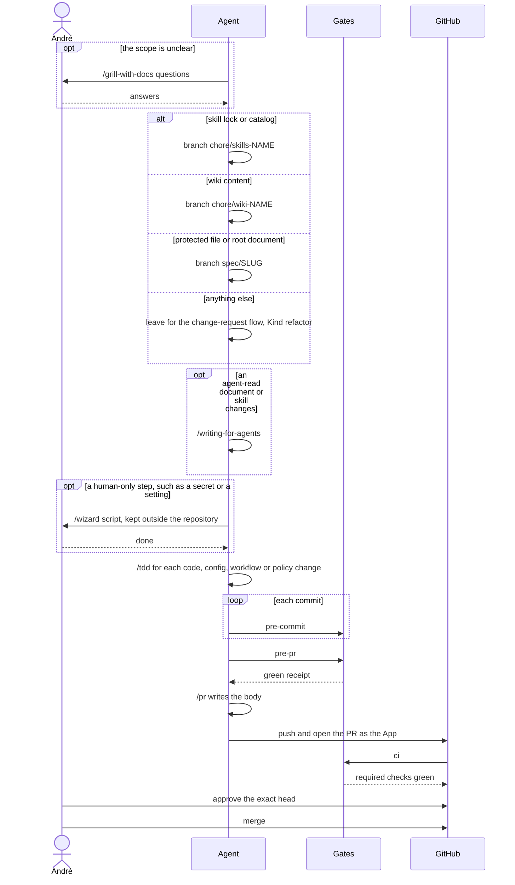
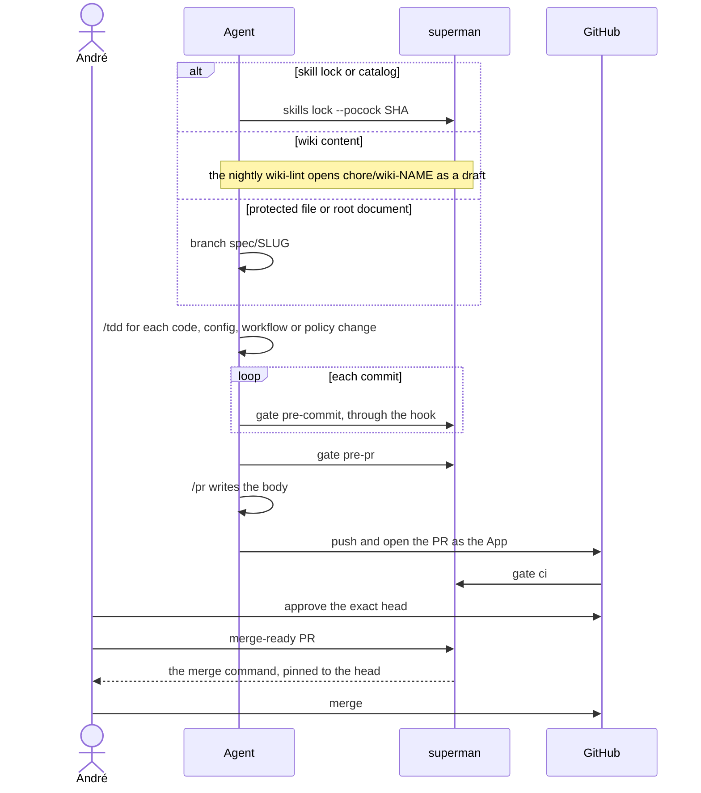
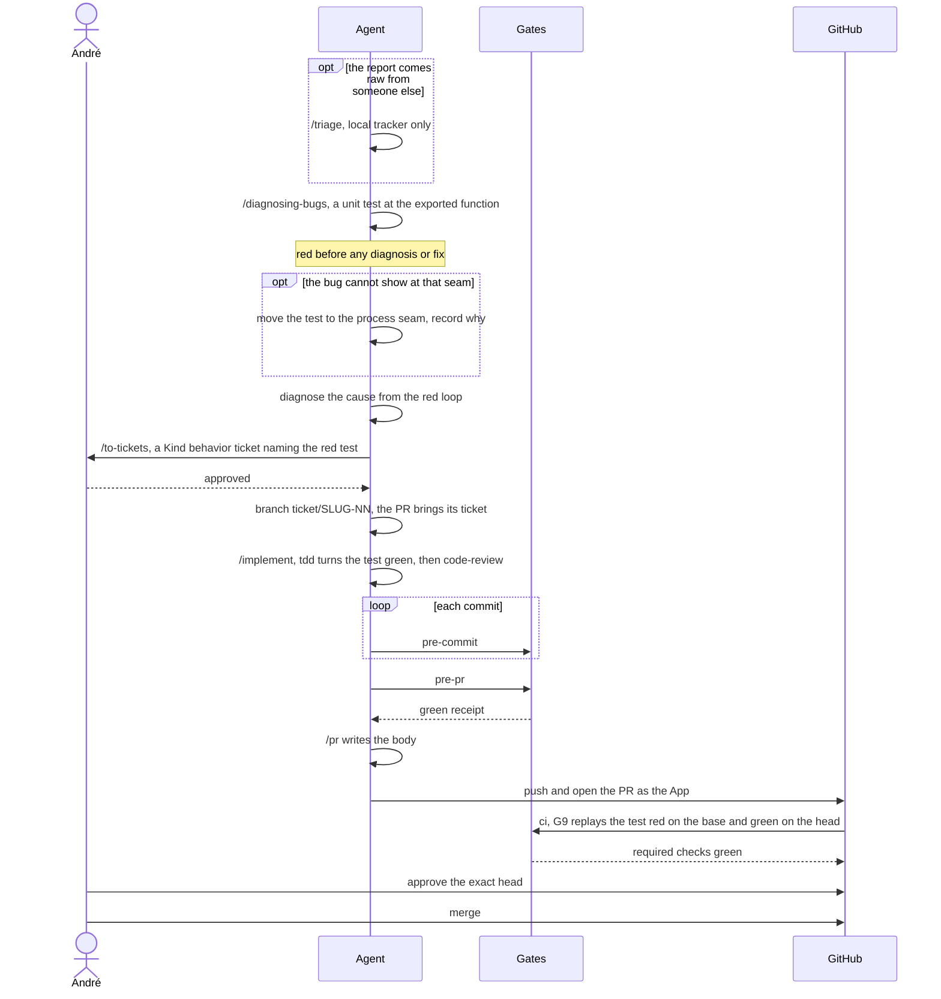
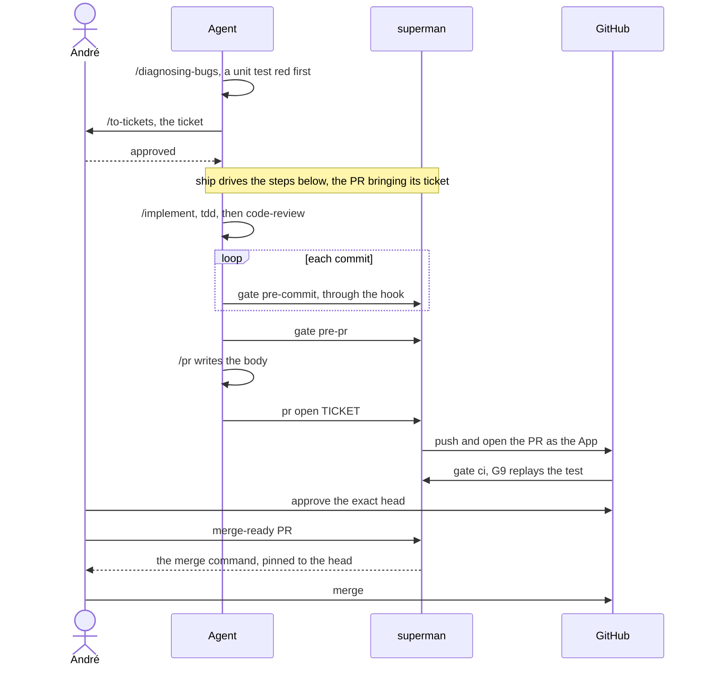
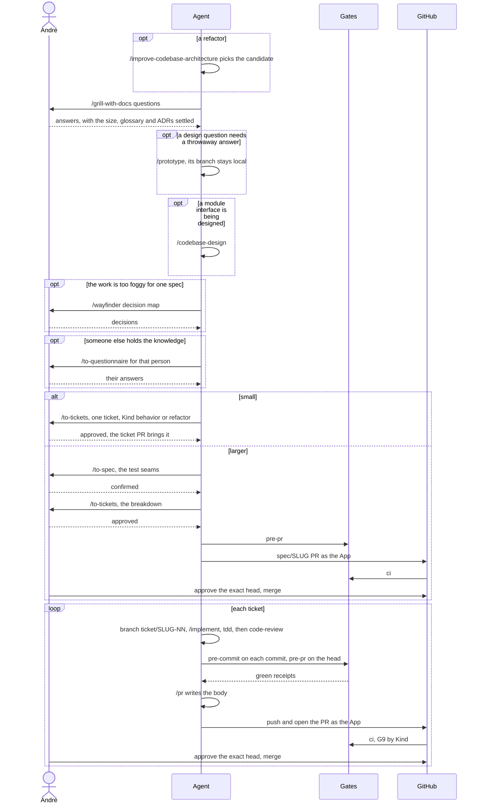
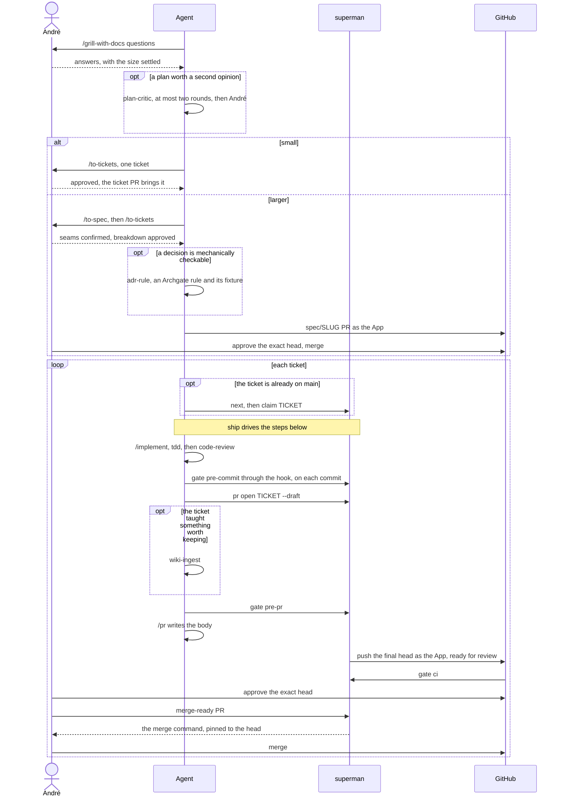

# superman workflows

**Status.** The `superman` CLI is **specified, not implemented**. This repository currently runs the Node bootstrap described in [Today's bootstrap](#todays-bootstrap-what-actually-runs); the Deno candidate beside it is parallel and non-admitting.

**How to read this.** The command *contract* — exact flags, exit codes, what each command must refuse — lives in [spec §5.2](.scratch/superman-v0/spec.md#52-cli-commands) and is not repeated here. This document holds the operational map: **which command answers which question, in what order, and what its result does and does not prove.** Where a row here says "contract", the spec is the authority; where it says a number or a path, the repository is the authority and the environment wins.

Every command exits `0` (ok), `1` (a gate failed) or `2` (misconfigured or a tool error). Every gate command writes a [receipt](GLOSSARY.md).

## Matt skills first, then superman

André's rule (2026-11-08) for every implementation and activity in this repository.

**Until the `superman` CLI exists** — the Gate 1 preparation and the v0 build — each activity runs through the Matt Pocock skill that fits it, and each executed step's record names the skill invocation that ran it. A step with no fitting skill records why.

| Activity | Skill |
| --- | --- |
| A decision, a design question, a stress test | `grill-with-docs` (grilling and domain-modeling) |
| A spec amendment | `to-spec`, amending the existing spec in place |
| A backlog change | `to-tickets`, reconciling the existing ticket ids |
| An implementation slice | `implement`, which runs `tdd` and `code-review` |
| A red run or a bug | `diagnosing-bugs` |
| A review | `code-review`, from a fixed point that includes the work under review |
| A PR body | `pr` |
| A session or harness change | `handoff` |
| The skills' repository configuration | `setup-matt-pocock-skills` |

A fitting Matt skill outside this set runs too. The set superman delivers and pins is the one [spec §5.6](.scratch/superman-v0/spec.md#56-skills-installation-and-context-budget) names; growing it is a §5.6 decision.

The skills run configured for this repository: the tracker is `.scratch/<slug>/`, and the domain documents are [GLOSSARY.md](GLOSSARY.md) and [docs/adr/](docs/adr/). `setup-matt-pocock-skills` writes that configuration into `AGENTS.md` and `docs/agents/` in its own spec-kind PR, right after Gate 1 merges and before ticket 01 (André, 2026-11-08).

**Once `superman` exists**, every command runs through it. superman invokes the skills — `ship` runs `implement`, `tdd`, `code-review` and `pr`, and planning stays `grill-with-docs` → `to-spec` → `to-tickets` — and keeps their configuration current through `superman init` and `superman skills lock|sync|verify`.

**Authority stays with superman's rules.** A commit, push, publication, label or merge that a skill would make by default happens only where [the three flows](#the-three-flows) or the preparation record allow it. One ticket is one PR with one human approval, so `implement-spec` stays outside the flow (spec §5.6). Upstream skill files stay byte-identical to the pin; this repository's configuration carries every adaptation.

## The three flows

Every piece of work follows one of three flows. Each flow shows today's form, run with Matt skills, and then its form with superman, which is specified, not implemented ([spec §5.2](.scratch/superman-v0/spec.md#52-cli-commands), §6.1 and §7). GitHub renders the diagrams; agents read their source and follow the numbered steps.

| The work | Flow |
| --- | --- |
| Changes nothing a user or the spec can observe: tool pins, CI, configs, documents, the skill lock, the wiki | [Chore](#chore) |
| Behaves differently from what the spec or a ticket already accepted | [Bugfix](#bugfix) |
| Changes the accepted behavior, new or different, or restructures code without changing behavior (a refactor) | [Change request](#change-request) |

When it is unclear which flow applies, run `grill-with-docs` first.

**Every flow keeps these rules.**

- **TDD is the only way to implement.** Every change to code, tests, config, workflows or policy goes red → green → refactor through `tdd`, directly or inside `implement`, with the red at the public seam that observes the change. Prose-only changes (records, WORKFLOW/README/GLOSSARY, ADR text) and evidence-only steps carry no red step.
- **André decides five things:** his grilling answers, `to-spec`'s test seams, `to-tickets`' breakdown, the exact-head approval and the merge. The agent pushes and opens PRs as the App identity, so main's last-push rule always finds an approver other than the pusher.
- **Gates are named by stage:** `pre-commit` on every commit, `pre-pr` before the push, `ci` on the PR. [Today's bootstrap](#todays-bootstrap--what-actually-runs) holds each stage's command; with superman each becomes `superman gate <stage>`.
- **A bugfix or a small change request brings its own ticket.** Small means one ticket's worth that changes no spec section, ADR, Archgate rule or protected path. The branch is `ticket/<slug>-<nn>` with a new `<nn>`, and the PR adds exactly that ticket file under `.scratch/`; G8 reads the ticket from the PR's head and G9 applies by its `Kind:`. This route is live once the policy PR after Gate 1 merges. Until then the ticket lands first in a spec PR, and the ticket PR follows that merge.
- **Each superman command replaces today's steps in the PR that makes it real.** When every step of a flow runs through superman, its superman diagram becomes the flow and today's is deleted.

Optional in every flow:

| Skill | Take it when |
| --- | --- |
| `research` | a fact needs primary sources |
| `handoff` | the session or the harness changes |
| `wait-what` | a message is unclear |
| `diagnosing-bugs` | a gate goes red unexpectedly |
| `retro` | the PR has merged, to improve the setup |

### Chore



1. **Route** the change by what it touches: the skill lock or catalog goes on `chore/skills-<name>`, wiki content on `chore/wiki-<name>`, a protected file or a root document on `spec/<slug>`. Anything else takes the [change request](#change-request) flow with a `Kind: refactor` ticket. *Done when* every changed path is one the branch kind allows.
2. **Implement** each code, config, workflow or policy change with `tdd`. *Done when* each red was seen at its seam and is green now.
3. **Check** with `pre-commit` on each commit and `pre-pr` on the head. *Done when* both receipts are green.
4. **Propose**: `pr` writes the body, and the agent pushes and opens the PR as the App. *Done when* `ci`'s required checks pass on the exact head.
5. **André** approves the exact head and merges.

Optional: `grill-with-docs` when the scope is unclear; `writing-for-agents` when an agent-read document or skill changes; `wizard` for a human-only step such as a secret or a setting, with its script kept outside the repository.

With superman (specified, not implemented):



### Bugfix



1. **Reproduce** with `diagnosing-bugs`: a unit test at the exported function of the module where the bug lives. *Done when* it is red for the bug itself (an assertion or a missing behavior, not a syntax, fixture or tool failure), before any diagnosis or fix.
2. **Climb** only when the bug cannot show at that seam: move the test to the process seam and record why. *Done when* that test is red.
3. **Diagnose** from the red loop. *Done when* the cause is named with the loop's evidence.
4. **Ticket**: `to-tickets` writes a `Kind: behavior` ticket whose acceptance criterion is the red test. *Done when* André approves it.
5. **Fix** with `implement`, which runs `tdd` and then `code-review`, on `ticket/<slug>-<nn>`, the PR bringing its ticket. *Done when* the red test is green, stays as the regression test, and code-review has no open finding.
6. **Check** with `pre-commit` on each commit and `pre-pr` on the head. *Done when* both receipts are green.
7. **Propose**: `pr` writes the body, and the agent pushes and opens the PR as the App. *Done when* `ci` passes, with G9 replaying the regression test red on the base and green on the head.
8. **André** approves the exact head and merges.

Optional: `triage` when the report comes raw from someone else, with the local tracker only.

With superman (specified, not implemented):



### Change request



1. **Grill** with `grill-with-docs`. *Done when* André confirms the shared understanding, including the size: **small** is one ticket's worth that changes no spec section, ADR, Archgate rule or protected path; anything else, and anything unsure, is **larger**.
2. **Small**: `to-tickets` writes one ticket, `Kind: behavior`, or `Kind: refactor` when no behavior changes. *Done when* André approves it; the ticket PR brings it.
3. **Larger**: `to-spec` amends `.scratch/<slug>/spec.md` in place, then `to-tickets` writes the tickets. *Done when* André has confirmed the test seams and approved the breakdown, and the `spec/<slug>` PR, with `pre-pr` green, pushed as the App and `ci` green, is approved on its exact head and merged.
4. **Implement** each ticket with `implement`, which runs `tdd` and then `code-review`, on `ticket/<slug>-<nn>`. *Done when* every acceptance criterion has a test that went red first and is green now, and code-review has no open finding. A refactor adds no assertion and keeps the suite green at every commit.
5. **Check** with `pre-commit` on each commit and `pre-pr` on the head. *Done when* both receipts are green.
6. **Propose**: `pr` writes the body, and the agent pushes and opens the PR as the App. *Done when* `ci` passes: G9 replays a behavior ticket's tests red on the base and green on the head, and a refactor keeps the suite green and the mutation score from dropping.
7. **André** approves the exact head and merges.

Optional: `improve-codebase-architecture` as the way into a refactor; `prototype` when a design question needs a throwaway answer, with its branch kept local; `codebase-design` when a module interface is being designed; `wayfinder` when the work is too foggy for one spec, its tracker writes under the authority rule; `to-questionnaire` when someone else holds the knowledge.

With superman (specified, not implemented):



## The workflows

### Adopt superman in a repository

Once, in a reviewed spec-kind PR.

```text
superman init --repo-kind ts     # configs, lock, ratchet, hook, AGENTS block, CODEOWNERS, CI
superman doctor                   # is the installation coherent? identities, tools, pins, hook config
```

`init` is byte-stable: re-running it shows no diff, and it refuses a modified generated file unless `--force` is explicit. It sets only a safe repo-local `core.hooksPath`. It never force-resets, installs or stages.

### Work a ticket

The agent's loop. Each ticket is exactly one PR.

```text
superman next                    # which ticket is eligible, from merged-base state
superman claim <ticket>          # reserve it across the clone's worktrees
   … implement, one slice at a time …
superman pr open <ticket>        # one PR, as the agent identity
```

`next` reads eligibility from merged-base state and excludes tickets that are claimed or already have a PR. `claim` is explicit about release and recovery; it never steals a live claim. `pr open` refuses a conflicting claim or PR, and it never approves or merges.

### Get fast feedback before committing

```text
superman gate pre-commit
```

Runs on the staged files and nothing else: `archgate check --staged`, typecheck, `biome check --staged --no-errors-on-unmatched`, the affected tests, knip, a protected-path check, the duplication check over the changed files, and the assertion that the staged content is green. It is **partial staged feedback** and its receipt says so; it never satisfies the full bar.

### Propose a branch as a PR

```text
superman gate pre-pr --base origin/main
```

The full blocking quality portfolio: tsrs plus the supplemental Deno checks, tests and overall coverage, fresh critical acceptance, strict Archgate, Biome, Trivy, knip, the full-corpus duplication baseline, equivalent-scope Stryker, and the applicable policy, integrity, traceability, replay and wiki checks.

### Understand what a change requires

```text
superman affected --staged --json   # changed files, affected targets, each one's reason chain
superman gate pre-pr --affected      # only the selected checks; unknown graphs force the full selection
```

`affected` is read-only and prints the change model the gates use. `--affected` narrows the work; a missing or untrustworthy safety state forces the uncached full run, and a missing tool never becomes an `n/a`.

### Decide whether a PR can merge

André's side, against the live forge.

```text
superman merge-ready <pr>
```

It verifies the seven conditions of [spec §9.2](.scratch/superman-v0/spec.md) against the forge rather than against a receipt: the approver's latest review is `APPROVED` with `commit_id == headSha`; the required workflow/job/App identities are present and successful for the integration evidence, with head H, tested base B and tested merge M checked against each other; the PR kind matches its branch and its changed files obey that kind's path policy recomputed from the forge; the base is `main`, the PR is mergeable and the evidence covers the current base.

It **prints** the merge command with `--match-head-commit` and stops. The human merges. The head flag guards the head only; strict base freshness is a separate, independently verified condition.

### A gate refuses

Read the receipt before you retry. The taxonomy names the reason: a missing tool, an ignored failure, skipped or absent required work, an incomplete or stale report, and a policy refusal are different failures and none of them is green. Retrying until green is not a repair.

### Audit and maintenance

```text
superman audit --since <date>     # approval/merge/direct-push violations, selection misses, stale passes
superman skills sync              # make the installed catalog match the lock
superman skills verify            # locally a warning; in CI a hard gate (G7)
superman wiki check --pr <number> # the G12 validator for a governed-knowledge change
```

## The command map

One row per command. The question is the operational trigger; the contract is the spec.

| Command | The question it answers | Contract |
| --- | --- | --- |
| `superman init` | "Set this repository up." | [§5.2](.scratch/superman-v0/spec.md) |
| `superman doctor` | "Is this installation coherent?" | [§5.2](.scratch/superman-v0/spec.md) |
| `superman gate pre-commit` | "Is my staged change good enough to commit?" | [§5.2](.scratch/superman-v0/spec.md), [§5.4](.scratch/superman-v0/spec.md) |
| `superman gate pre-pr` | "Is this branch ready to propose as a PR?" | [§5.2](.scratch/superman-v0/spec.md), [§5.4](.scratch/superman-v0/spec.md) |
| `superman gate ci` | "Does this head's integration with the base hold?" | [§5.4](.scratch/superman-v0/spec.md) |
| `superman gate pre-pr\|ci --affected` | "Which checks does this change actually require?" | [§5.2](.scratch/superman-v0/spec.md), [§5.7](.scratch/superman-v0/spec.md) |
| `superman affected` | "Which targets does this change affect, and why?" | [§5.2](.scratch/superman-v0/spec.md), [§5.7](.scratch/superman-v0/spec.md) |
| `superman merge-ready <pr>` | "May this PR be merged right now?" | [§5.2](.scratch/superman-v0/spec.md), [§9.2](.scratch/superman-v0/spec.md) |
| `superman pr open <ticket>` | "Open this ticket's one PR." | [§5.2](.scratch/superman-v0/spec.md) |
| `superman next` | "Which ticket can I claim next?" | [§5.2](.scratch/superman-v0/spec.md) |
| `superman claim <ticket>` | "Reserve this ticket across the clone's worktrees." | [§5.2](.scratch/superman-v0/spec.md) |
| `superman audit` | "Has anything bypassed the approval rules?" | [§5.2](.scratch/superman-v0/spec.md) |
| `superman skills sync` | "Make the installed catalog match the lock." | [§5.2](.scratch/superman-v0/spec.md), [§5.6](.scratch/superman-v0/spec.md) |
| `superman skills lock --pocock <sha>` | "Move the pinned Pocock/overlay version." | [§5.2](.scratch/superman-v0/spec.md) |
| `superman skills verify` | "Does the installed plugin cache still match the lock?" | [§5.2](.scratch/superman-v0/spec.md) |
| `superman wiki check` | "Is the governed wiki valid for this change?" | [§5.2](.scratch/superman-v0/spec.md), [§5.8](.scratch/superman-v0/spec.md) |
| `superman --version` | "Which build is this?" | [§5.2](.scratch/superman-v0/spec.md) |

## Today's bootstrap — what actually runs

The CLI does not exist yet. These are the real entry points in this repository, and they are what the preparation measures.

| Command | What it does |
| --- | --- |
| `node .superman/ci/raw-gates.ts --stage pre-commit\|pre-pr\|ci [--gate G] [--base <ref>] [--receipt <path>]` | The raw evaluator. One policy for the full local pre-PR run and the CI run; a partial stage reports partial feedback and never the full bar. |
| `node .superman/ci/coverage.ts [--mode full\|incremental\|nightly]` | The coverage collector. Four disjoint inventories — `node`, `product`, `candidate` and `deno` — each measured and reported on its own. The `deno` inventory is not measured by this host: it is carried from the Deno collector's own receipt. |
| `<pinned deno> deno run --no-prompt --no-config --no-lock --no-npm --no-remote --allow-read --allow-write --allow-env --allow-run .superman/deno-bootstrap/coverage.ts` | The Deno candidate collector. Its receipt is what the Node collector binds; its floor is carried, not met. |
| `<pinned archgate> check --strict --output json` | The rule engine for `.archgate/adrs/**`. |
| `node --test .superman/ci/*.test.ts` | The bootstrap suites. |
| `node .superman/ci/raw-gates.ts --gate G6` | The mutation measurement, on its own: the whole declared scope, the change compared at base and at candidate. It is the lane that carries the first-measurement survivor treatment. It is not part of the pull-request leg. |
| `node .superman/ci/raw-gates.ts --stage nightly` | The uncached full run: the whole declared scope, measured whole, at the previous `main` and at `main`. The declared pull-request scope and the whole scope are two declared scopes, and each lane applies the one it declares. |

The declared gate inventory per stage lives in `.superman/ci/bootstrap.json` under `stages` — read it there, not from this document. The pinned tool versions live in the same file under `tools`.

## What a result proves

Each result is evidence for one question. Stating what it proves keeps the rest honest.

| Result | What it proves | What it does not prove |
| --- | --- | --- |
| A pre-commit receipt | The staged files pass the staged checks, and the staged snapshot is the one that was checked. | The full quality bar. Its verdict is `partial-feedback` and it says so. |
| A pre-pr receipt | The branch passes the full local blocking portfolio with the reviewed pins. | Live forge approval, the required native-matrix evidence, or that the merge base is fresh. |
| A coverage receipt | The four independent overall floors of the inventory it names. | PR H/B/M admission, merge authority, or that another inventory's floor is met. |
| A red–green replay | Regression sensitivity: the behaviour test fails on the approved base and passes on the candidate. | The order in which the change was authored. |
| A candidate measurement | The Deno surface's own numbers, attributed to the collector that produced them. | A substitute for the Node required result before approval and merge. |
| A green gate | That gate's own deterministic check passed on the evaluated revision. | An approval. Only the [approver](GLOSSARY.md) merges, on the exact head. |
| A pull-request G6 result | The declared pull-request mutation scope, compared at base and candidate, and the declared critical cases executed fresh outside affected selection and result caches. | The whole-scope measurement. That is the nightly's and the owner's, and the receipt names the scope it applied. |
| A full-corpus G6 result | The measurement of the whole declared scope against the full-repository baseline, with the raw survivors. | A pull-request result. It is its own lane, and it is the one that carries the survivor treatment. |

## Where the authority lives

| | |
| --- | --- |
| The command contract | [spec §5.2](.scratch/superman-v0/spec.md) |
| The gate contract and the local/CI/nightly behaviour | [spec §5.4](.scratch/superman-v0/spec.md) |
| The change model and affected selection | [spec §5.7](.scratch/superman-v0/spec.md) |
| The merge conditions | [spec §9.2](.scratch/superman-v0/spec.md) |
| What blocks ticket 01 | [spec §17](.scratch/superman-v0/spec.md) |
| How a preparation step is judged | [ADR 0018](docs/adr/0018-admission-evidence-not-tool-correctness.md) |
| The vocabulary | [GLOSSARY.md](GLOSSARY.md) |
| The decisions | [docs/adr/](docs/adr/) (why) and [.archgate/adrs/](.archgate/adrs/) (enforced) |
| The preparation's live status | [.scratch/superman-v0/gate1-preparation.md](.scratch/superman-v0/gate1-preparation.md) |
| The measurements | [.superman/ci/bootstrap-evidence.md](.superman/ci/bootstrap-evidence.md) |
